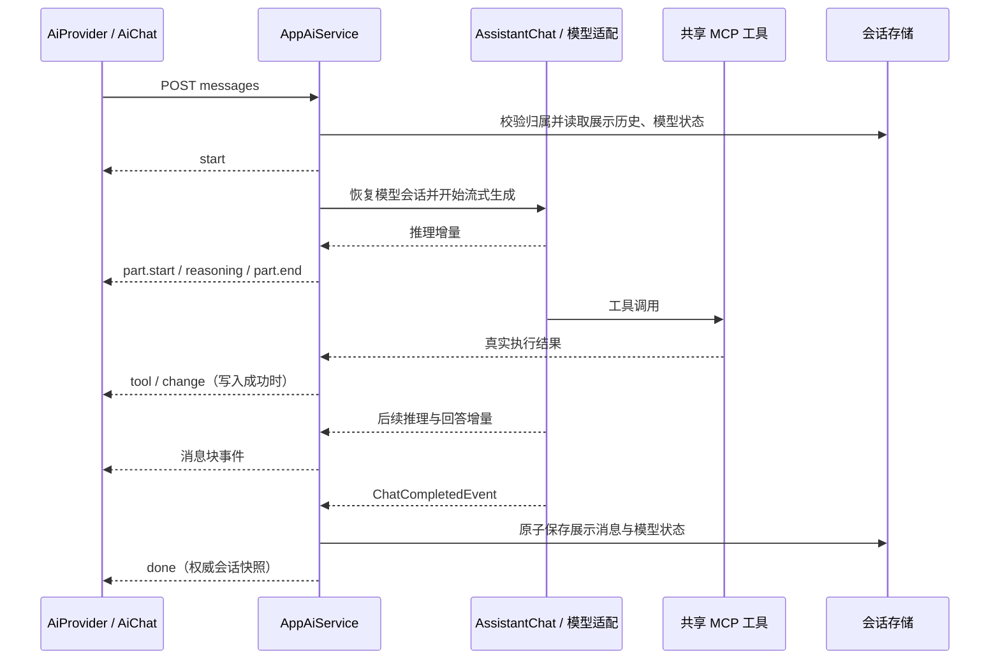

# AI 会话推理内容展示技术方案

版本：1.0 · 日期：2026-11-04 · 状态：技术设计，尚未实施

适用范围：Flexmodel Apps 的顶部助手、完整 AI 对话页和工作台内嵌对话。本文根据当前工作区代码设计；工作区包含尚未提交的 AI
流式会话及页面同步改动。文中的新增协议、配置、字段和组件均为实施建议，不表示已经交付。

## 1. 方案决策

采用 **供应商原生输出 → 后端结构化事件 → 前端可折叠内容块** 的方案。

- 保留声明式 `AssistantChat`、`Multi<ChatEvent>` 和现有 POST SSE 链路。
- 原生推理文本与正式回答分开处理；只返回摘要的模型展示“推理摘要”。
- 不提供推理输出的模型正常回答，不生成填充用的“思考过程”。
- 不通过提示词索取完整内部思维链，不以 `<thought>` / `<think>` 标签作为应用协议。
- 展示数据与供应商会话状态分别保存，避免工具调用及下一轮对话丢失模型所需状态。
- 首期接入现有 OpenAI 兼容链路中的 DeepSeek 原生推理；OpenAI Responses 摘要适配作为后续独立接入项。

标签折叠实现成本低，但标签属于普通正文，存在跨 chunk、未闭合及代码示例误识别的问题，也不能让 API 公开原本不返回的内部推理。对
OpenAI，应使用支持模型提供的推理摘要；官方不提供原始推理文本。[OpenAI：Reasoning models](https://developers.openai.com/api/docs/guides/reasoning)

## 2. 目标与边界

### 2.1 首期交付目标

1. 原生推理内容实时出现并支持折叠，与答案、工具执行正确交错展示。
2. 完成后重新进入会话，可恢复推理内容、回答和块顺序。
3. 无推理输出、仅推理后失败、用户停止、异常断流均有明确状态。
4. 工具调用前后保留供应商要求的模型状态，第二轮对话仍可正常使用工具。
5. 继续按真实工具结果产生 `change`，成功写入不因模型后续失败或取消而撤回。

### 2.2 本期不包含

提取隐藏思维链、通用 XML/HTML 标签解析、自动生成解释摘要、多供应商一次性全量接入、后台持续生成、断点续传、自动重放发送请求，以及将推理内容用作业务审计证据。

用户需要核对结论时，答案应提供可验证的数据、来源和必要计算步骤；折叠区域不承担结果真实性保证。提示词仅描述业务目标、约束与输出要求；推理模型通常无需额外强制逐步思考提示。[OpenAI：Reasoning best practices](https://developers.openai.com/api/docs/guides/reasoning-best-practices)

## 3. 当前实现与改造位置

下表路径以仓库根目录为基准，服务端路径中的 `...` 表示 `src/main/java/dev/flexmodel`。

| 位置                                                 | 当前行为                                                  | 建议改动                                   |
|------------------------------------------------------|-----------------------------------------------------------|--------------------------------------------|
| `flexmodel-server/.../apps/ai/AssistantChat.java`    | 已返回 `Multi<ChatEvent>`，共用 MCP 工具                  | 保留声明式接口                             |
| `flexmodel-server/.../apps/ai/AssistantAgent.java`   | 组装应用上下文、机器人提示词并调用模型                    | 选择模型能力配置；保持现有业务 SOP         |
| `flexmodel-server/.../apps/ai/AppAiService.java`     | 筛选回答、工具完成及最终完成事件；成功后保存              | 处理推理、中间响应、块边界及终态           |
| `flexmodel-server/.../apps/ai/dto/AiDtos.java`       | 消息只有 `content`；SSE 为 `token/tool/change/done/error` | 增加消息块与结构化生命周期事件             |
| `flexmodel-server/.../apps/ai/AppAiChatMemory.java`  | 最近 20 条展示消息转换成用户/助手文本                     | 根据供应商恢复模型状态，按完整交互单元裁剪 |
| `flexmodel-server/.../apps/ai/AiMessages.java`       | 展示消息 JSON 转换                                        | 支持新增块数据和校验                       |
| `flexmodel-server/src/main/resources/platform.fml`   | `f_app_ai_conversation.messages` 为 JSON                  | 增加仅服务端使用的模型状态字段             |
| `flexmodel-apps-ui/src/services/ai.ts`               | 解析 SSE，处理写入范围与完成事件                          | 扩展事件类型和回调，继续复用 `requestSse`  |
| `flexmodel-apps-ui/src/components/ai/AiProvider.tsx` | 草稿只有回答文本、当前工具名                              | 维护响应 ID、消息块和生成状态              |
| `flexmodel-apps-ui/src/components/ai/AiChat.tsx`     | Markdown 回答，支持停止及复制                             | 复用消息块渲染，增加折叠区域               |

当前实际会话入口为 `POST /api/ai/conversations/{id}/messages`；不是旧的按应用划分的端点。前端采用 React
18、Tailwind、shadcn/ui 风格基础组件，方案不引入 Ant Design 组件。

### 3.1 依赖能力核对

根 POM 使用 Quarkus 平台 BOM `3.33.1`。本机对应 BOM 管理的 Quarkus LangChain4j 为 `1.7.4`，LangChain4j core / open-ai 为
`1.11.0`。已检查这些版本的本地源码包：

- `ChatEvent.PartialThinkingEvent#getText()` 已存在，标记为实验能力。
- `IntermediateResponseEvent` 可取得工具调用轮次的完整响应。
- `OpenAiStreamingChatModel` 支持 `returnThinking`、`sendThinking`、`customParameters`；前两者默认关闭。
- `returnThinking(true)` 控制解析和回调，不负责开启模型本身的推理模式。

开发文档也描述了上述事件，但在线 `dev`
文档可能领先于项目版本；实施以解析后的依赖及桩测试为准。[Quarkus：Streamed Responses](https://docs.quarkiverse.io/quarkus-langchain4j/dev/guide-streamed-responses.html)

## 4. 总体链路



模型调用、工具执行、流式累积和持久化属于同一次生成。每次订阅单独创建累积器，禁止用共享可变对象保存不同请求的推理文本。继续使用现有
worker 调度处理数据库操作，避免在事件循环内阻塞。

## 5. 模型能力与配置

### 5.1 显式能力配置

引入小规模、服务端管理的模型配置；不根据域名或模型名称子串自动推断能力。建议表达以下概念，具体配置键在实施时集中定义：

| 配置概念           | 值                                            | 作用                                 |
|--------------------|-----------------------------------------------|--------------------------------------|
| `provider`         | `openai-compatible` / 后续 `openai-responses` | 选择协议及适配路径                   |
| `reasoningMode`    | `none` / `native` / `summary`                 | 声明对外展示内容的语义               |
| 供应商请求参数     | 模型支持的开关、强度、预算                    | 控制模型推理行为，不通过系统提示控制 |
| `displayReasoning` | 布尔值                                        | 是否向浏览器发送可展示推理内容       |

折叠面板是浏览器状态，展开或收起不改变请求参数。`displayReasoning=false`
也不等于关闭模型推理，更不能导致删除工具调用需要回传的状态。配置宣称支持但连续没有输出时记录诊断，不伪造内容，也不以此判定请求失败。

### 5.2 首期 DeepSeek 接入

通过针对 **streaming builder** 的 `ModelBuilderCustomizer` 设置解析、回传及供应商参数；不要只定制非流式模型，也不要自行新建客户端绕过
Quarkus 的密钥、URL、超时配置。

实施逻辑示意，以下不是完整 CDI 类：

```java
// 仅用于已明确配置为支持原生推理的 DeepSeek 模型。
builder.returnThinking(true);
builder.

sendThinking(true);
builder.

customParameters(Map.of("thinking", Map.of("type", "enabled")));
```

这些设置应合并其他已有参数，避免覆盖。推理模式下仅发送目标模型接受的采样参数；当前全局 `temperature=0.2`
不应被当成推理模式控制开关。LangChain4j 文档说明了 `returnThinking` / `sendThinking`
的用途。[LangChain4j：Thinking / Reasoning](https://docs.langchain4j.dev/integrations/language-models/open-ai/#thinking--reasoning)

DeepSeek 通过 `reasoning_content` 返回推理内容。当前官方协议对携带 `tools`
的请求要求保留并回传历史推理字段，不能只把回答文本送回；不带工具的普通对话规则不同。本项目声明了共享工具，必须验证真实请求体，而不能仅凭
UI 看见推理判定接入完成。[DeepSeek：Thinking Mode](https://api-docs.deepseek.com/guides/thinking_mode/)

### 5.3 后续 OpenAI Responses 接入

单独适配 Responses API，通过支持模型的 `reasoning.summary` 请求摘要，并将摘要增量映射到相同消息块，`source=summary`。不要向
`/chat/completions` 添加该参数后声称完成接入。相关 reasoning
items、工具项及供应商状态由适配器按协议管理；展示摘要不能替代这些状态。[OpenAI：Reasoning models](https://developers.openai.com/api/docs/guides/reasoning)

首期 `openai-compatible` 配置不声明已支持 Responses 摘要。若需要新增依赖，优先保持 Quarkus BOM 对齐，不单独覆盖 LangChain4j
核心版本。

## 6. 展示消息数据结构

复用 `Message.content` 作为最终回答，增加 `parts` 保存按出现顺序排列的内容块。用户消息不需要推理块。

```typescript
type PartStatus = 'streaming' | 'completed' | 'interrupted' | 'failed'

interface AiMessagePart {
  id: string
  type: 'reasoning' | 'text'
  source?: 'native' | 'summary' // reasoning 块必填，text 块不填
  round: number              // 一次用户请求内的模型调用轮次，从 1 开始
  content: string
  status: PartStatus
  truncated: boolean        // 仅表示展示内容达到长度上限
  elapsedMs?: number        // 块首事件至块结束的服务端观测时间
}

interface AiMessage {
  id: string
  role: 'user' | 'assistant'
  content: string            // assistant 仅存最终一轮的正式回答
  parts: AiMessagePart[]
  createdAt: string
}
```

约束：

- 历史及实时 UI 优先按 `parts` 渲染，不在其后重复渲染 `content`；无块的文本消息按 `content` 展示。
- 工具调用前的可见说明保存为对应轮次的 `text` 块，不拼进最终回答 `content`。
- 复制回复默认只复制最终回答；推理内容提供独立复制入口。
- 不把不同轮次的推理合成一个不断变化的大字符串；排序依据服务端事件顺序，不能依靠时间戳排序。
- `elapsedMs` 不是供应商内部思考耗时。前端如展示，使用“生成耗时”等表述；无内容时不伪造“思考了 N 秒”。
- 当前持久化只有成功完成的回复；`interrupted/failed` 用于前端本地草稿，见第 10 节。

## 7. SSE 协议

### 7.1 传输约定

复用现有 `requestSse` 的 POST + Fetch 读流方式，不改用仅支持 GET 的浏览器 `EventSource`。响应保持 `text/event-stream`，每个
SSE `data` 是完整 JSON；JSON 的 `type` 是唯一业务事件分类依据。

新增公共字段 `responseId`、`messageId`、`seq`。`messageId` 是助手回复 ID，流开始前生成并在最终持久化中复用；`responseId`
标识本次生成尝试；`seq` 从 1 开始逐事件递增，仅用于本次连接的排序与重复检查，不承诺事件回放。

### 7.2 事件表

| `type`       | 关键字段                         | 语义                                                             |
|--------------|----------------------------------|------------------------------------------------------------------|
| `start`      | `reasoningMode`                  | 已准入，标识符已分配；表示本次有效展示模式，不代表模型已产生推理 |
| `part.start` | `part`                           | 创建空内容块，状态为 `streaming`                                 |
| `reasoning`  | `partId`, `content`              | 向指定推理块追加展示文本                                         |
| `token`      | `partId`, `content`              | 向指定正文块追加文本，沿用现有事件名称                           |
| `part.end`   | `part`                           | 该块权威完整快照，**替换而非追加**                               |
| `tool`       | `toolCallId`, `content`, `stage` | 工具名与 `started/completed/failed` 阶段，不含完整参数和结果     |
| `change`     | `change`                         | 沿用现有真实成功写入的资源范围                                   |
| `done`       | `conversation`                   | 展示消息与模型状态保存成功，携带权威会话快照                     |
| `error`      | `code`, `content`                | 失败终态，返回可公开错误文案                                     |

`start/part.start` 的完整示例：

```text
data: {"type":"start","responseId":"resp1","messageId":"msg1","seq":1,"reasoningMode":"native"}

data: {"type":"part.start","responseId":"resp1","messageId":"msg1","seq":2,"part":{"id":"p1","type":"reasoning","source":"native","round":1,"content":"","status":"streaming","truncated":false}}

data: {"type":"reasoning","responseId":"resp1","messageId":"msg1","seq":3,"partId":"p1","content":"供应商返回的可展示推理文本片段"}

data: {"type":"part.end","responseId":"resp1","messageId":"msg1","seq":4,"part":{"id":"p1","type":"reasoning","source":"native","round":1,"content":"供应商返回的可展示推理文本片段","status":"completed","truncated":false,"elapsedMs":420}}

```

后续可以是工具事件、新一轮推理及文本块，最终以 `done` 或 `error` 结束。保留 `token/tool/change/done/error`
是复用现有语义，不增加新旧协议双轨兼容层。

### 7.3 必须满足的协议规则

1. 每个块先 `part.start`，后增量，最后 `part.end`；空推理不创建块。
2. `part.end` 用当前累计内容关闭块，轮次完整响应到达后可再次发送同 ID 的 `part.end`
   快照校准；前端始终替换内容，不重复追加，也不重新展开该块。缺少增量但完整响应带有推理时，补发 `part.start` 和 `part.end`
   。块关闭后禁止再追加增量；再次出现同类型内容时创建新块。
3. 每次请求至多一个终态，终态后不再发送块或工具事件；流无终态结束视为连接中断。
4. HTTP 鉴权、参数和并发校验在 SSE 建立前返回常规 4xx；建立后失败发送 `error`。
5. `done` 必须在持久化成功之后发出。保存失败即 `error`，不能把生成成功等同于保存成功。
6. 前端以 `done.conversation` 替换草稿，不把流式块与快照再合并一次。
7. 不因 EOF 自动补 `done`，不自动重新 POST；工具可能已经产生业务写入。

部署时关闭本路径的反向代理响应缓冲，及时 flush SSE。可每 15 秒发送 SSE 注释心跳 `: ping`，不计入业务 `seq`
；心跳只维持连接，不证明上游生成正常。当前模型超时配置为 60 秒，实施时按首事件等待、上游空闲和整体生成耗时分别评估，避免长推理被代理或客户端提前截断。

## 8. 后端事件累积与轮次边界

在 `apps/ai` 特性包增加请求级累积器，例如 `AiResponseAccumulator`，集中负责块 ID、轮次、长度限制及快照，避免让 Resource
或提示词承担协议解析。

| LangChain4j 输入            | 后端动作                                                         |
|-----------------------------|------------------------------------------------------------------|
| `PartialThinkingEvent`      | 创建或追加当前轮次推理块，生成 `reasoning`                       |
| `PartialResponseEvent`      | 结束当前活跃推理块，创建或追加正文块，生成 `token`               |
| `IntermediateResponseEvent` | 用完整响应校准本轮内容；封闭本轮块，保存供应商中间状态           |
| `BeforeToolExecutionEvent`  | 确保活跃文本块已封闭，发 `tool(stage=started)`                   |
| `ToolExecutedEvent`         | 发工具结果阶段；复用 `AiToolChanges.from(...)` 产生真实 `change` |
| 下一次模型调用的文本或推理  | 新建下一轮块，工具事件本身不重复递增轮次                         |
| `ChatCompletedEvent`        | 校准末轮，封闭全部块，保存展示消息与供应商状态，再发 `done`      |
| 异常                        | 封闭活跃块为失败状态，再发一次 `error`，释放本次资源             |

初始轮次为 1；每个 `IntermediateResponseEvent`
结束一次模型响应，随后轮次递增一次。一个响应可以请求多个工具，因此不能按工具数量递增。若供应商以其他顺序或并行方式回调，适配层应先规范化；本期不新增并行工具执行能力。

不要只给现有 `.select().where(...)` 加一个推理类型就结束：它还会丢弃轮次边界。只有最终 `ChatCompletedEvent`
才能完成整次用户请求，工具前的中间响应不能触发落库或 `done`。

同轮次也可能出现内容类型切换；一个块只对应一段连续的同类输出。必须分别判断推理字段和正文字段，不能用 `if ... else` 假定同一个供应商
chunk 只含一种内容。

无最终文本的处理沿用现有兜底回答，但不把推理文本当作正式回答；若模型因预算耗尽、协议错误而未完成，返回明确失败而不是正常兜底。
`finishReason` 的具体映射由适配器测试固定。

## 9. 存储与模型记忆

### 9.1 展示层存储

`f_app_ai_conversation.messages` 继续保存用户消息和助手展示消息，在助手消息上增加 `parts`，不新增独立推理表，也不逐 token
更新数据库。成功后与模型状态在同一事务中保存，刷新页面通过现有会话列表接口恢复。

`content` 保留最终回答投影，`parts` 保留可见交互顺序。已有仅文本消息可在读取时表达为一个正文块；这是空字段默认语义，无需建设旧协议兼容模块，也无需修改原文。

### 9.2 模型状态单独保存

建议在同一会话模型增加 `model_state: JSON`，仅供服务端适配器使用，包含供应商/模型标识、状态格式版本，以及继续对话所需的模型消息或状态引用。不得直接通过
`Conversation` DTO 返回浏览器。

该字段按需要保存推理数据、工具请求/结果及相关关联 ID；不是 SSE 事件日志，也不是展示块的副本。DeepSeek 路径应恢复带
`thinking` 的 `AiMessage` 及完整工具交互，按其要求回传；其他供应商的签名或不透明状态不得改写为普通摘要文本。

当前 `AppAiChatMemory` 仅从 `Message.content` 重建 `AiMessage`
，必须随本期改造，否则第一轮展示正常也可能在后续工具请求失败。裁剪模型历史时按完整用户交互和关联工具组裁剪，并同时满足供应商的回传要求；不能简单截取最后
20 个底层消息而切断工具配对。若协议要求无法在上下文预算内满足，明确要求新建会话，不静默丢失必需状态。

需要为本次生成提供请求级模型记忆/状态收集器，能在最终完成时取得包含中间响应和工具结果的模型历史；仅从最后一个
`ChatCompletedEvent` 无法重建全部历史。成功时原子保存，失败或取消时丢弃未保存的临时模型记忆，避免同一个 `@MemoryId`
的缓存让下一次请求带入失败轮次。状态键应包含用户、机器人、会话及生成标识，权限仍由会话归属校验决定。

切换供应商、模型或状态格式不兼容时，新建模型会话段，并仅以普通用户/最终回答文本作为新段背景；不跨供应商回放专有 reasoning
数据。需要完整连续状态的场景应新建会话并提示用户。

## 10. 前端状态与交互

### 10.1 状态管理

`AiProvider` 的流式草稿增加 `responseId/messageId/parts/lastSeq`；保持按用户和机器人隔离的房间模型。服务层只解析协议、核对
`change` 并调度缓存失效；组件不直接拼接接口地址。

收到 `start` 后绑定本次响应；只接收匹配响应的事件，重复序号忽略，序号跳跃或未知必需事件视为协议错误，停止追加并保留已显示内容。请求结束后的过期回调不得写入新的生成状态。后端同一会话同一时刻应只准入一次生成，冲突返回
409；多实例部署前必须落实共享准入控制，单靠浏览器 `busy` 不能保证这一点。

### 10.2 折叠区域

在 `AiChat.tsx` 附近增加 `AiReasoningBlock`，三个对话入口共用同一渲染路径。优先复用现有可折叠基础组件；若不存在，使用原生
`details/summary`，不为此新增 UI 库。

- `source=native` 标题“思考过程”，`source=summary` 标题“推理摘要”；不标注为完整内部思考。
- 首个推理块在生成时默认展开，块结束后默认收起；用户手动操作后，后续事件不覆盖其展开选择。
- 历史推理块默认收起；空内容不占位，只有等待状态时使用现有生成提示。
- 原生推理首期按纯文本展示；正文继续复用 `ReactMarkdown`，不启用原始 HTML。
- 普通答案中的 `<thought>`、代码块及数学比较符均作为正文处理，不触发折叠。
- 默认复制最终回答，推理块提供独立复制；用户输入内容不参与标签解析。
- 保留浅色/深色语义色，检查移动端换行与键盘展开；块变化只在用户接近滚动底部时自动跟随，阅读历史时不强制跳底。

### 10.3 终止规则

| 场景                 | 前端                                                         | 服务端及持久化                                 |
|----------------------|--------------------------------------------------------------|------------------------------------------------|
| 正常完成             | 权威快照替换草稿                                             | 原子保存成功后 `done`                          |
| 模型/工具链路失败    | 保留已收到块，标记失败，不再显示生成动画                     | 发 `error`，不保存为成功回复                   |
| 浏览器主动停止       | `AbortController` 中止，保留本地用户消息及部分块，标“已停止” | 取消订阅并尽力取消上游，不保证撤销执行中的工具 |
| 无终态断流           | 保留草稿，标“连接中断”，允许用户核对后再次发送               | 不推断生成或保存成功                           |
| 已保存但 `done` 丢失 | 连接中断后重新拉取当前会话快照核对                           | 成功存储的消息以服务器为准，不重复发送用户请求 |

本期失败/停止片段只保留在当前浏览器内存，刷新后以服务端成功历史为准；不承诺断点继续。重新发送可能重复业务动作，不能自动重试。已收到的
`change` 在所有结束路径仍须触发缓存核对，遵循 [AI 写操作后的页面同步](../../flexmodel-server/docs/ai-refresh.md)。

## 11. 长度、日志与运行限制

- 建议每次响应最多保存 64 Ki 个 Unicode 码点的展示用推理文本；达到上限后保留已有内容并设置 `truncated=true`
  ，不影响回答生成。该值是项目建议默认值，不是供应商限制。
- 展示截断不应破坏 `model_state`。供应商状态大小及上下文预算需另行限制；达到限制时终止生成并明确报错，不能悄悄截断必需字段。
- 前端使用现有调度方式或每帧合并增量更新，避免每个 token 触发整个会话重新渲染；合并仅限同一块且不跨生命周期/工具事件。
- 超时、取消和完成必须释放本次累积器及订阅。客户端停止不等于供应商停止计费，工具副作用只能按真实结果处理。
- 生产环境关闭原始模型请求/响应日志。当前 `application.properties` 开启了两项日志，实施时应调整为开发显式启用；默认日志仅记录响应
  ID、供应商/模型、错误码、耗时和可用的 token 用量。
- 分别观测首个推理事件延迟、首个正文事件延迟和总生成时间，不把首个推理 token 到达视为答案已可用；没有供应商用量时不根据字符数伪造推理
  token。
- 推理与模型状态可能包含业务数据，沿用当前会话所有者鉴权和删除路径；`model_state` 不暴露给浏览器，错误不拼接原始上游响应。

## 12. 实施步骤

| 顺序 | 内容                                                  | 完成条件                                         |
|------|-------------------------------------------------------|--------------------------------------------------|
| 1    | 固定 DeepSeek 配置与能力，补充 streaming builder 定制 | 桩请求体确认开关、解析和回传行为；不修改业务 SOP |
| 2    | DTO、请求级累积器、SSE 映射及轮次边界                 | 无工具/多工具/多轮均符合第 7 节协议              |
| 3    | 展示块、私有模型状态及历史恢复                        | 成功消息重载一致，第二条消息可再次调用工具       |
| 4    | 前端协议、Provider、折叠渲染                          | 三个入口一致，停止/断流不丢失已显示草稿          |
| 5    | 错误、限制、日志及写入刷新回归                        | 不重放写操作，缓存失效不回退，检查全部通过       |

先完成一条供应商链路的端到端交付，再扩展 Responses 摘要适配。本文文档交付不等于上述功能实施完成。

## 13. 验证与验收

优先扩展已有 `OpenAiStubTestResource`、`AppAiModelFlowTest`、`AppAiResourceTest`、`AiToolChangesTest`、前端服务测试及
`playwright.ai.config.ts`，不要求真实付费 API 才能完成自动验收。

| 场景                          | 必须验证的结果                                       |
|-------------------------------|------------------------------------------------------|
| 原生推理 → 回答               | 推理不进入答案正文，折叠/复制独立，`done` 不重复追加 |
| 无推理输出                    | 无空折叠块，普通回答与复制正常                       |
| 推理 → 工具 → 推理 → 回答     | 轮次和块顺序正确，多工具不多计模型轮次               |
| 连续两条含工具的消息          | 下游真实请求体含供应商必需状态，工具 ID 成对         |
| 只有完整响应带推理            | `part.end` 校准或补发，不与增量重复                  |
| 仅推理后报错 / 预算耗尽       | 显示失败，无正常 `done`，不把推理充当答案            |
| 取消、异常 EOF、`done` 丢失   | 动画结束，保留草稿，拉取快照核对且不自动 POST        |
| 重复终态、重复/过期事件       | 至多一次完成，不污染下一次响应                       |
| 成功写入后模型失败或停止      | `change` 仍生效，已完成业务写入不被假定回滚          |
| 推理超限                      | 标记展示截断，原生回传字段完整或明确失败             |
| 正文含 `<thought>` / 代码示例 | 原文正常显示，不被识别为推理块                       |
| 重载历史、切换入口            | 同一消息内容和块顺序一致，历史块默认收起             |
| 多用户与同会话并发            | 跨用户拒绝，同会话第二请求在调用模型前拒绝           |

实施后的建议验证命令：

```bash
./init.sh

mvn test -pl 'flexmodel-server,!flexmodel-engine/flexmodel-maven-plugin' -am \
  -Dtest=AppAiModelFlowTest,AppAiResourceTest,AiToolChangesTest \
  -Dsurefire.failIfNoSpecifiedTests=false -Dquarkus.scheduler.enabled=false

cd flexmodel-apps-ui
npm run build
npm test
npx playwright test --config playwright.ai.config.ts
```

功能验收要求：目标行为实现、以上相关测试实际运行、证据写入功能追踪文件、标准启动路径可重新执行。真实供应商联调另记录模型标识及协议能力，不在文档或日志中保存密钥。

### 13.1 本次文档交付的检查记录

2026-11-04 已运行标准 `./init.sh`：全模块 clean compile 与引擎测试通过；脚本附带的 `flexmodel-ui` E2E 为 32 通过、3
失败，失败均为页面导航等待 `load` 超时，涉及 GraphQL API、接口日志及项目列表页。因此完整启动检查未通过，不能据此宣称基线全绿。输出保存在仓库根目录
`.codex-reasoning-plan-init.log`。

本次只新增方案和文档索引、更新追踪记录，没有实现推理展示，也没有为排查上述无关页面超时修改业务代码。文档交付检查包含
Markdown 代码围栏、本地链接、SSE JSON 示例及新增追踪项；第 13 节的功能测试清单留待实施时执行。

## 14. 评审关注点与未决事项

1. **供应商能力**：当前实际配置的模型是否支持推理与工具同时使用，需实施时以模型文档、桩断言和一次真实联调共同核实；不能仅凭
   OpenAI 兼容声明确认。
2. **模型状态大小**：首期状态存同一会话 JSON，复用现有事务；超长历史或更大规模对话再评估拆表与分页，不在本期建设通用事件存储。
3. **并发部署**：确认上线实例数并落地会话准入控制；未验证共享控制前，不宣称支持多实例下同会话并发安全。
4. **实验 API**：`PartialThinkingEvent` 为实验接口，版本升级需重跑事件与回传契约测试，业务 DTO 不直接暴露框架事件类。

## 15. 参考资料

官方页面核对日期：2026-11-04。供应商事实以相邻链接为依据；协议、长度、UI 和存储取舍为本文针对 Flexmodel 的设计建议。

- [Quarkus LangChain4j：Streamed Responses](https://docs.quarkiverse.io/quarkus-langchain4j/dev/guide-streamed-responses.html)
- [Quarkus LangChain4j：Models](https://docs.quarkiverse.io/quarkus-langchain4j/dev/models.html)
- [LangChain4j：Thinking / Reasoning](https://docs.langchain4j.dev/integrations/language-models/open-ai/#thinking--reasoning)
- [OpenAI：Reasoning models](https://developers.openai.com/api/docs/guides/reasoning)
- [OpenAI：Reasoning best practices](https://developers.openai.com/api/docs/guides/reasoning-best-practices)
- [DeepSeek：Thinking Mode](https://api-docs.deepseek.com/guides/thinking_mode/)

项目核对位置：根 `pom.xml`、`flexmodel-server/pom.xml`、`apps/ai` 特性包、`platform.fml`、Apps UI 的 `services/ai.ts`、
`components/ai` 及 [页面同步说明](../../flexmodel-server/docs/ai-refresh.md)。
