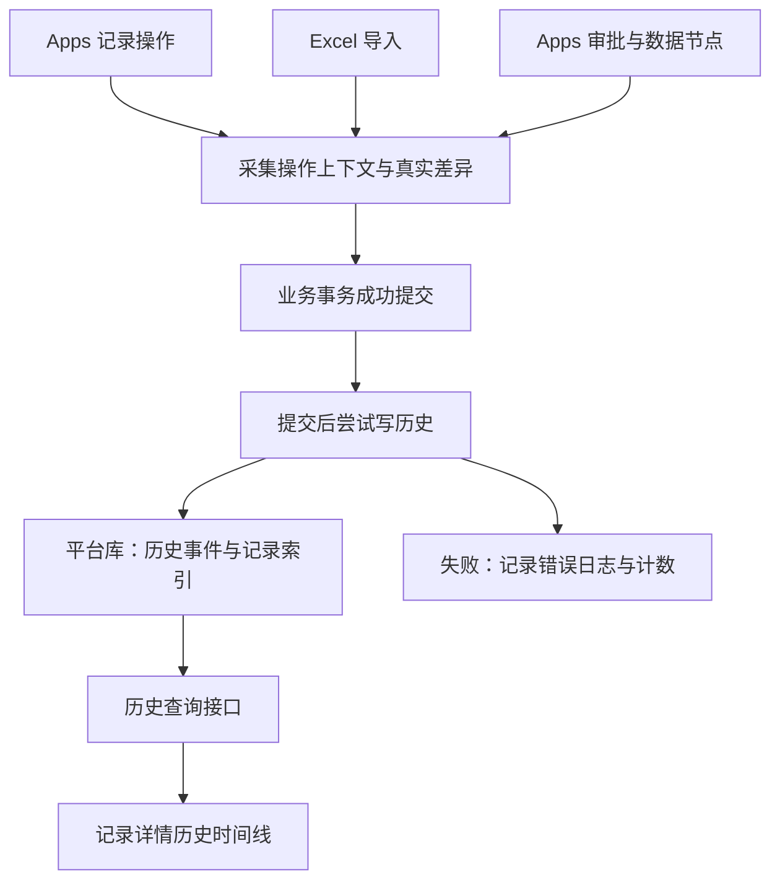

# Apps 表单记录历史功能技术方案

## 一、目标、范围与现状

### 1.1 建设目标

将记录详情右侧的“历史”从前端模拟数据改为真实操作时间线，能够回答：

- 谁在什么时间创建、修改了记录。
- 哪些字段发生变化，修改前后分别是什么。
- 哪些子记录被新增、修改、删除。
- 哪些附件被关联、移除或替换。
- 谁提交了审批，谁进行了签核，流程最终如何结束。

本期采用 **轻量日志方案**：业务操作成功后尽力记录历史，历史失败不影响业务结果。不建设可靠事件投递、版本快照、历史恢复或完整审计系统。

### 1.2 已确认的功能范围

| 项目         | 本期约定                                                              |
|--------------|-----------------------------------------------------------------------|
| 表单范围     | 应用业务表单，不含用户、角色、部门等内置系统表单                      |
| 写入来源     | Apps 表单操作、Excel 导入、Apps 审批及审批数据节点                    |
| 通用数据入口 | 不覆盖独立 REST 数据接口、GraphQL、通用 MCP、普通流程和外部直连数据库 |
| 主子表展示   | 子记录保留自身历史，主记录汇总关联子记录变化                          |
| 附件历史     | 记录附件字段实际保存后的关联变化                                      |
| 讨论         | 保留现有讨论面板，不重复写入历史                                      |
| 留存         | 默认长期保留，不自动过期                                              |
| 删除记录     | 保留历史，不提供回收站或恢复                                          |
| 删除表单     | 清理该表单自身历史及指向该表单记录的历史索引                          |
| 删除应用     | 清理应用全部历史                                                      |
| 历史数据补录 | 不根据当前记录反推或生成旧历史                                        |

### 1.3 现有实现与问题

当前实现主要位于：

- `flexmodel-apps-ui/src/data/recordHistoryMock.ts`：生成模拟历史。
- `flexmodel-apps-ui/src/components/biz/useRecordHistoryMock.ts`：组装当前用户、记录和审批数据。
- `flexmodel-apps-ui/src/components/biz/RecordActivityAside.tsx`：展示时间线。

目前存在以下问题：

1. 创建时间缺失时，根据记录 ID 生成伪时间。
2. 修改前的数值使用当前值乘以比例生成。
3. 创建人、修改人可能直接使用当前登录用户。
4. 审批结果包含固定姓名与推算时间。
5. 没有真实历史查询接口、分页和持久化数据。

后端已有可复用基础：

- `AppRecordService`：业务记录增删改与子表上下文校验。
- `AppTransferExecutor`：Excel 批量写入。
- Apps 审批服务：提交、签核、运行状态及数据节点执行。
- `ProjectUnitOfWork`：事务边界与提交后回调。
- 平台模型、Repository、项目清理机制。
- 讨论面板的加载、错误、重试、分页和目录头像能力。

现有 `AuditEventListener` 面向配置资源审计，受资源白名单控制，缺少表单、主子表和审批语义，本期不直接作为记录历史的数据来源。

---

## 二、总体架构与数据设计

### 2.1 架构选择

采用“ **业务服务显式采集 + 提交后独立写入平台库 + 按记录查询**”。



业务库与平台库可能使用不同数据库连接。现有 `ProjectUnitOfWork` 明确将跨库事务作为独立事务处理，因此本方案
**不承诺业务数据与历史原子提交**。

历史写入边界：

- 业务回滚：不写历史。
- 业务提交成功：尝试写历史。
- 历史写入失败：不撤销业务，不把业务响应改成失败。
- 进程在业务提交后、历史写入前退出：允许永久漏记。
- 本期不增加业务库事件表、消息队列、后台补偿或自动补录。

这是已选择的可靠性边界，产品与运维文档均应保持一致。

### 2.2 模块职责

继续按 Apps 特性垂直组织，新增以下职责：

| 组件                         | 职责                               |
|------------------------------|------------------------------------|
| `AppRecordHistoryResource`   | 历史列表、事件详情接口             |
| `AppRecordHistoryService`    | 访问检查、分页、查询结果投影       |
| `AppRecordHistoryRecorder`   | 接收服务端事件，提交后安全写入     |
| `AppRecordHistoryDiff`       | 字段规范化、差异计算、展示快照     |
| `AppRecordHistoryRepository` | 平台历史事件与目标索引持久化       |
| `AppRecordHistoryContext`    | 操作人、来源、操作标识及审批上下文 |

不在 Resource 中直接操作 Repository，不在前端计算真实差异，不修改独立引擎客户端的行为。

### 2.3 为什么分为事件与目标索引

一条子记录变更可能同时出现在：

- 子记录自身时间线。
- 一个或多个关联主记录时间线。

如果复制完整历史内容，后续容易出现同一次操作数据不一致。因此采用两张平台表：

1. **历史事件表**：保存一次真实操作。
2. **历史目标表**：保存该操作应该展示在哪些记录中。

两表写入放在同一个短平台事务内，保证一条历史不会只写事件、不写展示索引。

这不改变业务与历史之间的轻量一致性约定。

### 2.4 历史事件表

建议模型名：`f_app_record_history`，在 `platform.fml` 定义。

| 字段           | 类型         | 含义                              |
|----------------|--------------|-----------------------------------|
| `id`           | String       | UUID，事件唯一标识                |
| `project_id`   | String       | 应用 ID，沿用平台隔离方式         |
| `event_key`    | String       | 服务端生成的事件去重键            |
| `operation_id` | String       | 同一次导入、节点执行等关联标识    |
| `form_name`    | String       | 实际被操作的业务表单              |
| `form_label`   | String       | 表单名称快照                      |
| `record_id`    | String       | 实际被操作的记录 ID               |
| `record_label` | String，可空 | 主显字段摘要快照                  |
| `event_type`   | String       | 事件类型                          |
| `source`       | String       | `APPS`、`IMPORT`、`APPROVAL`      |
| `actor_type`   | String       | `USER` 或 `SYSTEM`                |
| `actor_id`     | String，可空 | 真实操作人 ID                     |
| `actor_name`   | String       | 姓名快照或“系统”                  |
| `occurred_at`  | DateTime     | 业务操作发生时间，统一按 UTC 解释 |
| `recorded_at`  | DateTime     | 历史实际写入时间                  |
| `changes`      | JSON         | 字段变化及展示快照                |
| `context`      | JSON         | 主子表、导入、审批等扩展信息      |
| `trace_id`     | String，可空 | 现有链路标识                      |

索引：

- 唯一索引：`project_id + event_key`。
- 来源记录索引：`project_id + form_name + record_id + occurred_at + id`。

`event_key` 只用于同一历史事件重复写入时去重，不能代替业务幂等机制。

### 2.5 历史目标表

建议模型名：`f_app_record_history_target`。

| 字段          | 类型     | 含义                   |
|---------------|----------|------------------------|
| `id`          | String   | UUID                   |
| `project_id`  | String   | 应用 ID                |
| `event_id`    | String   | 历史事件 ID            |
| `form_name`   | String   | 时间线所属表单         |
| `record_id`   | String   | 时间线所属记录         |
| `target_type` | String   | `SELF` 或 `PARENT`     |
| `occurred_at` | DateTime | 事件时间，用于分页排序 |

约束与索引：

- 唯一索引：`project_id + event_id + form_name + record_id`。
- 查询索引：`project_id + form_name + record_id + occurred_at + event_id`。

同一事件通过多条关系关联到同一主记录时，仅展示一次，关系字段列表放入事件上下文。

查询时先分页读取目标索引，再批量读取事件，避免逐条查询。

### 2.6 事件分类

| 事件                     | 说明                   |
|--------------------------|------------------------|
| `RECORD_CREATED`         | 创建记录，包含导入创建 |
| `RECORD_UPDATED`         | 业务字段发生实际变化   |
| `RECORD_DELETED`         | 删除记录               |
| `APPROVAL_SUBMITTED`     | 成功发起审批           |
| `APPROVAL_TASK_APPROVED` | 某个执行人同意当前任务 |
| `APPROVAL_TASK_REJECTED` | 某个执行人拒绝当前任务 |
| `APPROVAL_APPROVED`      | 整个审批最终通过       |
| `APPROVAL_REJECTED`      | 整个审批最终拒绝       |
| `APPROVAL_TERMINATED`    | 审批进入现有终止状态   |

子表和附件不另建第二套事件：

- 子表事件通过 `PARENT` 目标显示为“新增／修改／删除了子记录”。
- 附件通过字段差异中的新增、移除项显示。
- 一次保存同时修改普通字段和附件，只产生一条记录更新事件。

签核动作与流程结果必须区分。例如会签中的一人同意，不能显示为“审批已通过”。

---

## 三、采集规则、事务与边界处理

### 3.1 操作上下文

操作上下文必须由服务端创建，不接受客户端提交的操作人、时间或事件类型。

来源规则：

| 场景                 | 操作人         | 来源与关联信息                         |
|----------------------|----------------|----------------------------------------|
| 手动新增、修改、删除 | 当前登录用户   | `APPS`                                 |
| Excel 导入           | 导入提交人     | `IMPORT`，关联 `importId`              |
| 提交审批             | 提交人         | `APPROVAL`，关联审批实例               |
| 人工签核             | 实际任务执行人 | 关联实例、任务、节点                   |
| 审批自动修改数据     | 系统           | 关联实例、节点，并保存发起人作为上下文 |
| 流程自动结束         | 系统           | 保存最终状态及实例关联                 |

不能因为异步执行中存在请求上下文，就把自动操作记成某位当前用户。

操作时复制姓名与展示信息，后续改名不覆盖历史姓名；头像可以按用户 ID 使用当前目录信息加载。

### 3.2 记录新增

处理顺序：

1. 沿用现有表单校验、默认值和系统字段赋值。
2. 执行新增。
3. 读取实际保存结果，包含数据库生成值。
4. 生成创建事件和主子表目标。
5. 在当前业务事务提交后尝试写历史。

创建事件保存业务字段的初始值，详情可展开查看。排除 `id`、创建／更新人、创建／更新时间等系统维护字段，避免与事件头部重复。

已有记录上线后直接修改，只产生真实修改事件，不虚构过去的创建事件。

### 3.3 记录修改与差异计算

差异必须来自“实际保存前的记录”和“实际保存后的记录”，不能直接比较请求对象与前端缓存。

基本规则：

- 未提交字段不等于被清空。
- `null`、空字符串、`0`、`false` 分别处理，不能用真假值判断空值。
- 只有系统更新时间变化，不生成业务修改事件。
- 数值按字段语义规范化比较，避免 `1` 与 `1.0` 产生伪变化。
- 日期、时间和日期时间分别规范化。
- 引用字段比较 ID，展示时使用名称快照。
- 多选与标签按现有字段语义比较；无顺序语义时不因重排产生变化。
- JSON 对象忽略键顺序；数组是否保留顺序按字段类型确定。
- 前端格式化前缀、千分位不参与原始值比较。

差异结构：

```json
{
  "fieldName": "amount",
  "fieldLabel": "金额",
  "fieldType": "DECIMAL",
  "before": "100.00",
  "after": "120.00",
  "beforeDisplay": "¥100.00",
  "afterDisplay": "¥120.00"
}
```

`before`、`after` 保存可序列化的类型值；高精度数值使用十进制字符串，避免 JavaScript 精度损失。

不保存整条记录的版本快照。本期数据仅用于解释操作，不能作为恢复依据。

### 3.4 并发写入

轻量日志允许漏记，但已经写入的前值不应被另一请求污染。

SQL 业务库中的记录修改、删除采用：

1. 进入该操作的业务事务，已有外层事务时复用。
2. 使用现有行锁机制锁定目标记录。
3. 读取旧值、写入、读取新值并计算差异。
4. 提交后记录历史。

不同记录不增加应用级串行锁。多记录操作按稳定记录顺序取锁，降低死锁风险。

该事务调整用于获得正确的前后值，不能使业务库和平台库变为原子事务。

第一版验证以现有事务能力已覆盖的 SQLite、MySQL 为基准。非 SQL 数据源不新增强制事务调用，保留原
CRUD；历史能力响应为不支持，界面明确提示，不能伪装为空历史或声称并发前值可靠。

### 3.5 历史写入与异常隔离

`AppRecordHistoryRecorder` 接收已经复制完成的事件数据，并通过提交后回调执行。

具体要求：

- 回调内开启独立平台事务。
- 事件与全部目标索引一起写入。
- 唯一键重复只作为已记录处理。
- 其他异常捕获并输出结构化错误。
- 不把数据库异常传播到已成功的业务请求。
- 不在提交后重新读取可能已经变化的原记录。
- 不把业务回滚前采集的数据提前写入历史。
- 历史表不触发自身历史，避免递归。

当前 `afterCommit` 回调异常可能向上传播，因此异常隔离必须写在 Recorder 内，不能仅依赖事务工具。

### 3.6 Excel 导入接入

现有导入使用批量插入，不能只修改单条 `createRecord` 方法，否则导入不会留痕。

接入位置在导入执行器的真实写入链路：

- 每条成功新增记录生成一条 `RECORD_CREATED`。
- 同一次导入共用 `operation_id`，来源为 `IMPORT`。
- 按批采集事件，整个导入事务成功后再分批写历史。
- 整包回滚时，不产生任何历史。
- 导入预览、上传、导出不产生记录历史。
- 历史批次失败不把已成功导入改为失败。

事件去重键使用 `importId + formName + recordId + eventType` 的稳定摘要。

不以历史是否存在判断导入是否完成，不改变现有导入凭据及业务幂等机制。现有导入机制自身的故障窗口不由本功能解决。

### 3.7 主子表历史

父记录关联关系必须由服务端根据表单布局、引用字段与实际记录值计算，不能信任客户端传入的主记录 ID。

覆盖以下入口：

- 在主记录抽屉中新增、编辑、删除子记录。
- 在子表独立列表中修改记录。
- Excel 导入子记录。
- 审批数据节点修改子记录。

展示规则：

- 子记录时间线：显示完整的自身变更。
- 主记录时间线：显示子表名称、子记录名称和变更摘要。
- 关联由主记录 A 改为 B：A 显示移出，B 显示移入，子记录显示实际引用字段变化。
- 删除子记录：使用删除前的数据确定父记录。
- 同一操作关联同一父记录多次：仅展示一次。

只汇总表单配置中明确声明的 `SUBFORM` 关系，不把所有普通引用关系都当作主子表，不递归汇总祖先。

现有普通文本关联字段也应按照已配置的子表关系处理，复用导入模块已识别的关系语义。

### 3.8 附件历史

附件历史以记录字段保存成功为准：

- 上传文件但取消编辑：不记。
- 文件上传成功但保存记录失败：不记。
- 保存后新增、移除、替换附件：记录字段差异。
- 多附件按稳定文件标识比较新增、移除项。

仅保存文件 ID／稳定引用、文件名等必要信息，不保存文件内容或临时签名下载链接。

第一版历史只展示附件名称和变化，不增加历史附件直接下载入口，避免绕过现有附件鉴权。

### 3.9 审批历史

在真实状态变化的位置生成事件：

- 提交成功后记录一次提交。
- 签核成功后记录实际签核人与意见。
- 只有实例进入终态时才记录流程最终结果。
- 审批数据节点修改记录，沿用记录变更事件，并携带审批来源。

审批重复请求必须沿用现有业务幂等判断。命中已处理结果时，不重新制造事件。

去重键示例：

- 提交：实例 ID + 提交事件。
- 签核：任务 ID + 决策事件。
- 最终结果：实例 ID + 终态。

审批业务事务提交后，独立尝试写历史；失败不影响审批结果，也不依赖历史推动流程继续。

### 3.10 删除与留存

- **删除记录**：删除前采集必要摘要与差异，成功后记录删除事件；保留既有历史。
- **删除子记录**：关联主记录仍能看到删除摘要。
- **删除表单**：清理以该表单为来源的事件及其所有目标，同时清理以该表单为目标的索引；保留仍有独立来源意义的其他表单事件。
- **删除应用**：将两张历史表纳入现有项目平台数据清理清单。
- **删除字段**：不批量改写历史存储；读取时按当前可见字段投影。

普通记录详情接口仍要求记录存在。删除后的历史保留在存储中，本期不增加独立管理员查询已删除记录的页面。不能把“保留历史”描述为“已提供回收站查询”。

---

## 四、接口、权限与前端交互

### 4.1 历史列表接口

```http
GET /api/apps/{appId}/forms/{formName}/records/{recordId}/histories
    ?size=20
    &cursor=...
```

返回示例：

```json
{
  "supported": true,
  "list": [
    {
      "id": "event-uuid",
      "kind": "RECORD_UPDATED",
      "source": "APPS",
      "actor": {
        "type": "USER",
        "id": "user-uuid",
        "name": "张三"
      },
      "occurredAt": "2026-10-29T06:20:00.000Z",
      "targetType": "SELF",
      "summary": "修改了 2 个字段",
      "changeCount": 2,
      "changesPreview": [
        {
          "fieldName": "amount",
          "fieldLabel": "金额",
          "fieldType": "DECIMAL",
          "beforeDisplay": "¥100.00",
          "afterDisplay": "¥120.00"
        }
      ],
      "hasMoreChanges": true
    }
  ],
  "nextCursor": null,
  "hasMore": false
}
```

约定：

- 默认每页 20 条，最大 50 条。
- 按 `occurred_at DESC, event_id DESC` 稳定排序。
- 使用不透明游标，携带最后一项的排序位置和目标记录标识。
- 游标必须校验格式与所属应用／表单／记录。
- 新写入历史通过刷新首屏获取，不插入正在浏览的旧分页。
- 列表默认预览最多 3 个可见字段变化。
- 不返回昂贵的全量总数。

同一时间的事件按 ID 稳定排列；此顺序用于展示，不代表跨数据库的严格因果顺序。

### 4.2 历史详情接口

```http
GET /api/apps/{appId}/forms/{formName}/records/{recordId}/histories/{eventId}
```

返回完整的 **授权后变更详情**、关联子记录摘要或审批摘要。

必须先确认事件属于当前路径所指定记录的历史目标，再返回内容，不能只按 `eventId` 查询。

不提供客户端创建、更新、删除历史的接口，也不提供恢复接口。

### 4.3 权限规则

复用当前登录身份与 `AppMenuService.canAccessForm` 等已有能力：

1. 必须登录。
2. 应用、业务表单和记录必须有效。
3. 必须能访问当前表单。
4. 每次查询显式限制 `project_id`。
5. 事件详情必须属于当前记录。
6. 内置系统表单返回 `supported=false`，前端不展示历史入口。

当前数据权限尚未接入运行时，因此本期不能宣称已经具备行级、字段级授权引擎。

历史返回值至少遵循当前记录布局的字段投影：

- 当前不展示或已经删除的字段，不返回原值、新值或预览。
- `changeCount` 根据实际返回的可见变化计算，不能泄露隐藏字段名称。
- 对主记录中的子表事件，再检查子表访问范围；无权访问时隐藏子记录名称、字段值及可跳转标识，只保留通用事件提示。
- 审批意见等详细内容沿用现有审批详情访问判断；没有权限时只返回基本流转摘要。

业务库中的原始记录、平台历史表均不直接暴露给前端。

### 4.4 展示快照

历史名称与值的展示使用操作时快照：

- 操作人改名：保留当时姓名。
- 选项改名：保留当时选项标签。
- 引用记录改名或删除：保留当时名称。
- 字段标签变更：展示事件中保存的标签，但仍服从当前字段可见范围。
- 无法解析名称：回退到真实 ID，不编造名称。
- 目录头像失败：回退姓名首字。

展示快照解析属于尽力增强，不应因为被引用对象已删除而阻断业务。

### 4.5 前端接入

新增服务与 Hook：

```ts
listRecordHistories(appId, formName, recordId, query)
getRecordHistory(appId, formName, recordId, eventId)
useRecordHistories({appId, formName, recordId, enabled})
```

历史类型从 UI 组件迁移到服务层，避免数据模块依赖组件类型。

删除模拟历史生成器与 `useRecordHistoryMock`，所有真实历史请求统一放入 `src/services/`。

交互要求：

- 首次切换“历史”时加载，收起侧栏后停止历史请求。
- 切换记录时立即清空前一条记录的状态。
- 隔离迟到响应，避免 A 记录结果显示到 B 记录。
- 支持加载中、空态、失败重试和加载更多。
- 初次加载失败不显示“暂无历史”。
- 加载更多失败保留已加载内容。
- 长文本先展示摘要，点击后读取详情；按纯文本渲染。
- 合并分页后重新按日期分组，避免相同日期重复标题。
- 新增、修改、子表操作、提交审批和签核成功后，使相关历史查询失效。
- 历史页提供手动刷新；页面重新获得焦点时刷新首屏。
- 不增加历史专用 SSE 或常驻轮询。

时间通过带 `Z` 的 UTC 字符串传输，按浏览器本地时区分组和展示；时间提示提供完整年月日、时分秒。

空态文案建议：

> 暂无操作历史。历史功能启用后的操作会记录在这里。

第一版不增加搜索、筛选器、独立历史页面、版本号或恢复按钮。

---

## 五、实施顺序、验证与验收

### 5.1 实施顺序

**阶段一：存储与查询**

- 定义历史事件、目标索引模型及生成类型。
- 实现平台 Repository、分页接口、详情接口和访问检查。
- 实现事件记录器、差异计算与提交后异常隔离。
- 将历史模型加入应用删除清理路径。

**阶段二：业务记录链路**

- 接入新增、修改、删除及事务内前后值读取。
- 接入主子表关联与附件差异。
- 接入导入批量写入，避免遗漏绕过单条 CRUD 的路径。
- 接入表单删除清理。

**阶段三：审批链路**

- 接入提交、任务签核和实例终态。
- 为自动数据节点传递显式系统操作上下文。
- 验证重复请求与会签场景不产生错误事件。

**阶段四：前端替换与文档**

- 接入历史服务与 Hook，移除 mock。
- 完成分页、详情、刷新、错误状态和主题适配。
- 将本方案落为 `flexmodel-server/docs/record-history.md`，补充 Server README 入口。
- 在功能追踪中新增独立历史功能项，记录实施与验证结果，不把方案完成标记为功能已实现。

### 5.2 后端测试

| 类别     | 必测场景                                               |
|----------|--------------------------------------------------------|
| 新增     | 默认值、真实操作人、生成 ID、创建时间与初始字段        |
| 更新     | 多字段、无变化、部分更新、清空、`0`、`false`           |
| 字段类型 | 高精度数值、日期、多选重排、引用名称快照、JSON         |
| 并发     | 同记录并发更新的前后值连续；不同记录互不串值           |
| 事务     | 业务失败无历史；外层回滚无历史                         |
| 异常隔离 | 平台库写历史失败，业务与响应仍成功                     |
| 导入     | 整包成功、整包回滚、5000 条上限、稳定事件去重          |
| 子表     | 抽屉操作、独立列表、导入、审批修改、父记录转移         |
| 附件     | 上传未保存、保存失败、新增、移除、替换                 |
| 审批     | 提交幂等、重复签核、会签部分通过、最终通过／拒绝／终止 |
| 访问     | 未登录、跨应用、无表单访问、事件不属于记录、子表受限   |
| 投影     | 隐藏字段、删除字段、无权查看的审批详情                 |
| 分页     | 同时间多事件、分页期间新增、非法或跨记录游标           |
| 删除     | 记录删除保留、表单清理、同名重建、应用整体清理         |

故障测试还应明确验证：业务提交后直接终止进程可能缺少历史，这是接受的轻量方案边界。

### 5.3 前端测试

- 真实空数据不生成任何模拟事件。
- 请求失败与空态分开显示。
- 切换记录时迟到响应不会串数据。
- 分页无重复，跨页日期分组正确。
- 保存后刷新历史，失败不影响记录已保存状态。
- 子表摘要与自身详情展示正确。
- 长文本、空值、数字和布尔值显示正确。
- 浅色、夜间模式及窄屏可正常阅读。
- 历史内容中的 HTML 和脚本作为纯文本显示。
- 系统表单、非 SQL 历史不支持状态展示明确。

### 5.4 验证命令与基线要求

实施时先运行标准 `./init.sh`，再执行新增历史专项测试及 Apps 构建。

规定后端检查：

```bash
mvn clean compile -pl '!flexmodel-engine/flexmodel-maven-plugin'
mvn test -pl flexmodel-engine
```

Apps UI 执行 `npm run build`，并运行新增的历史服务、Hook 与记录详情交互测试。

当前连续性记录显示，标准 `init.sh` 曾被运行中的开发 JAR 文件锁阻塞。实施时应重新确认；若仍存在，记录实际失败原因，并使用非
`clean` 编译补充验证，不擅自停止用户服务。

本次仅完成只读调研与方案设计，未修改仓库，也未运行构建或测试；以上为实施阶段的验证要求。

### 5.5 上线与运维

- 新增平台模型与索引后启用采集，再切换前端真实接口。
- 不迁移 mock，不补造旧创建、旧修改或旧审批记录。
- 错误日志包含应用、表单、记录、事件类型、操作标识和链路标识，不输出字段原值。
- 使用现有监控能力记录写入成功数、失败数与写入耗时。
- 无自动过期任务，长期容量随操作数量增长。
- 估算容量时使用“日事件量 × 平均事件大小 × 留存天数”，目标索引按实际父关联数量另计。
- 不承诺所有数据库和原生镜像已验证；验收证据明确列出数据库与运行方式。

### 5.6 最终验收标准

1. 历史面板不再依赖模拟时间、固定姓名和推算前值。
2. 所选 Apps 写入入口均已接入，导入和审批自动修改不遗漏。
3. 普通字段、附件、子表及审批动作符合上述事件语义。
4. 业务回滚不生成历史，历史失败不使成功业务返回失败。
5. 列表和详情按应用、表单、记录隔离，并遵循当前可见范围。
6. 分页、刷新、错误重试与记录切换通过验证。
7. 记录删除、表单删除、应用删除符合已确认留存策略。
8. `progress.md` 和 `feature_list.json` 记录真实测试证据与轻量日志限制。

**本期交付的是可解释业务操作的真实历史时间线；完整性保障采用已确认的尽力记录策略。**

