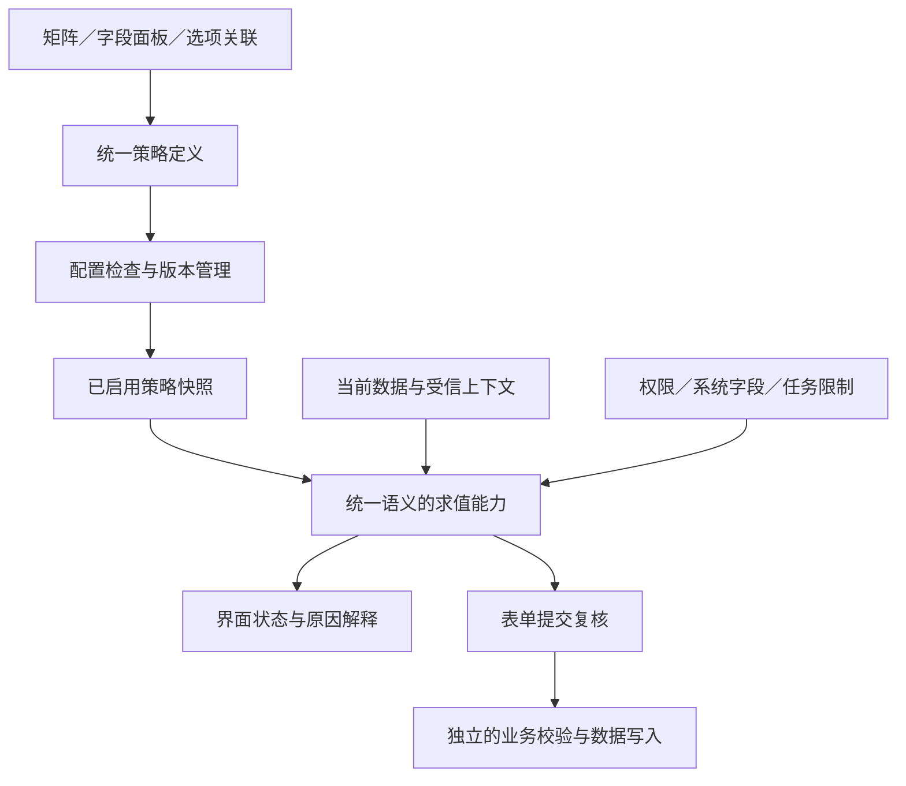

# 低代码平台表单显示控制技术方案

版本：1.0 · 日期：2026-11-02 · 状态：产品与技术设计建议，供评审

适用对象：以业务人员、业务系统管理员为主要搭建者，以开发人员为扩展使用者的表单型低代码／零代码平台。

本文独立设计，不以任何现有仓库、技术栈或历史实现为前提；不涉及代码、接口签名、数据库建表或具体框架选型。竞品事实来自官方公开文档，未进行各平台账号内的完整实操；“建议”“取舍”和评分均为本文的设计判断，不代表厂商结论或市场统计。各产品能力可能受版本、应用形态及配置影响。

## 阅读导航

- 希望快速决策：阅读第 1、4、5、23 节。
- 负责产品与交互：阅读第 3、6—10、16、21 节。
- 负责架构与研发评审：阅读第 11—15、17—20 节。
- 负责测试与交付：阅读第 21—22 节。
- 需要核对竞品：阅读第 3、24 节，相关结论旁附有官方链接。

## 1. 推荐结论

推荐采用 **“场景状态矩阵 + 字段条件配置 + 统一规则总览 + 生效结果解释”** 的组合。

用户日常看到的是四种直观状态： **隐藏、只读、可编辑、必填**
；进一步设置时才展开“什么条件下显示／可编辑／必填”。选项关联作为快捷入口，与字段条件共享同一份配置。规则总览负责检索和治理，首期不承担所有规则的主要创建入口。

核心取舍如下：

| 问题                                   | 推荐决策                                                 | 接受的代价                                   |
|----------------------------------------|----------------------------------------------------------|----------------------------------------------|
| 普通用户是否必须理解规则引擎？         | 不需要，先用状态矩阵和条件表单                           | 极复杂场景需要进入高级条件                   |
| 是否支持条件显示？                     | 首个完整版本就支持                                       | 需要从一开始定义空值、回退与值保留语义       |
| 显示、只读、必填是否做成独立勾选框？   | 外层用互斥状态，内层按可见／可编辑／必填三个属性表达     | 内部模型比界面多一层                         |
| 条件显示是否需要同时配置反向隐藏规则？ | 不需要，“满足条件才显示”自带反向语义                     | 不提供任意动作组合的全部自由度               |
| 同一个字段可否被十几条规则反复覆盖？   | 同一场景、同一属性只有一个有效策略；多个条件合并到策略内 | 少数用户需要把独立规则改写为条件组           |
| 是否引入自由脚本、公式或事件流程图？   | 首期不引入                                               | 无法在显示控制里完成任意计算、赋值、接口调用 |
| 是否把角色权限也塞进显示控制？         | 分开配置，最终结果一起解释                               | 需要建立权限与表单策略的清晰边界             |
| 隐藏时是否自动清空？                   | 默认不清空；不隐式写入数据库                             | 某些业务需要另配明确的数据清理动作           |
| 是否只做前端效果？                     | 前端即时反馈；需要强制的写约束由服务端复核               | 双端需要相同语义和一致性用例                 |

**最值得投入的复杂度，是“结果可预测、原因可解释、提交不意外”。** 不建议把首期预算投入无限嵌套条件、任意执行顺序、可编程脚本与节点连线。

## 2. 问题定义与产品边界

### 2.1 “显示控制”实际上包含几类问题

用户说“这个字段不该出现”时，背后可能是完全不同的诉求：

| 用户说法                   | 实际问题                   | 应归属的能力                     |
|----------------------------|----------------------------|----------------------------------|
| 选择公司客户才显示税号     | 当前业务分支是否需要此字段 | 条件显示                         |
| 新建时填写，提交后只能看   | 生命周期中什么时候可修改   | 场景状态／业务写约束             |
| 财务才能看到成本价         | 谁有权读取敏感数据         | 字段权限                         |
| 部门经理审批时填写意见     | 当前任务允许操作哪些内容   | 流程节点字段策略                 |
| 列表里不想看地址           | 视图呈现与个人偏好         | 列设置／视图配置                 |
| 只有金额超过阈值才显示按钮 | 哪些动作在当前状态可用     | 动作可用性，后续复用条件能力     |
| 隐藏以后把旧的收货地址删掉 | 数据如何改变               | 数据动作／业务规则，不是单纯显示 |

这些能力可以共享条件编辑器和结果解释方式，但不能因此混成一个没有边界的大规则引擎。

### 2.2 本方案覆盖范围

主要覆盖字段及表单分组在新增、编辑、详情和审批填写场景中的可见性、可编辑性与交互必填。进一步说明与权限、数据约束、导入导出和流程的边界。

首期不承担以下能力：跨表查询联动、计算赋值、远程接口调用、库存扣减、业务状态流转、任意脚本、通用工作流编排、复杂动态布局生成。这些需求有价值，但应有各自的产品入口和执行语义。

### 2.3 设计假设

1. 搭建者主要理解业务字段和条件，未必理解变量、函数、事件或执行顺序。
2. 表单通常由数十个字段组成，也可能增长到上百个字段；首期要可维护，但不以极端大表单驱动全部设计。
3. 新增、编辑与查看共用主要字段结构，场景间存在少量差异。
4. 平台可能有审批和数据权限；即使暂时没有，也应避免未来接入时重做规则语义。
5. 不要求一开始建立完整应用发布流水线，但需要配置版本、原子保存和回退能力。

这些假设应通过真实用户访谈验证，而不是当成已被证明的市场结论。

## 3. 主流平台如何设计

### 3.1 简道云：字段快捷入口与表单规则统一

**官方公开做法：**
在表单属性中配置字段显隐规则，条件由字段、比较关系和比较值组成，支持“所有／任一”。单选和下拉字段也有快捷设置入口，产生的规则同步到表单显隐规则。文档还明确了详情展示、多级显隐与规则规模的边界。[官方：字段显隐规则](https://hc.jiandaoyun.com/doc/12232)

**设计判断：** 适合借鉴的是“用户从哪里想到需求，就从哪里配置；平台内部仍只有一个事实来源”。字段面板和规则总览可以并存，不能各保存一套彼此独立的条件。

**对本方案的启示：** 保留选项关联的低门槛，同时让规则可统一查找。复杂级联的具体语义应明确设计，不能仅靠搭建者反复试出来。

### 3.2 钉钉宜搭：选项关联降低首次使用门槛

**官方公开做法：**
单选、复选、下拉单选和下拉复选可以为选项关联组件，匹配时展示，未选择时隐藏。若权限组已将目标组件隐藏，选项匹配也不能使它出现；该能力还有子表单使用限制。[官方：关联选项设置](https://docs.aliwork.com/docs/yida_support/wtwabe/acu61g/pw4kp6)

**设计判断：** “选了什么，就出现什么”与填表者和搭建者的思路很接近。它适合作为快捷功能，但无法独自覆盖金额、日期或多字段组合条件。

**对本方案的启示：** 快捷入口可以收窄表达力，底层不应另起炉灶。权限禁止读取的字段，始终不能被联动放出来。

### 3.3 明道云：统一业务规则，表达力强，语义也更复杂

**官方公开做法：**
业务规则由条件和动作构成，可调整显隐、编辑、必填，也可赋值、提示或锁定。其文档专门解释动作的反向执行、原始属性回退、多规则优先级，以及表格等场景中的降级；还举出了两条显示规则因反向隐藏而相互冲突的例子。[官方：业务规则](https://help.mingdao.com/worksheet/business-rule/)

**设计判断：** 完整规则体系可以覆盖更多业务，但用户需要学习的已不仅是“字段、条件、结果”，还包括动作撤销与冲突裁决。

**对本方案的启示：** 借鉴条件与动作的清晰表述，首期限制动作范围；优先在模型中减少冲突，避免依赖越来越长的优先级说明。

### 3.4 Microsoft Power Apps：必须区分两条产品路线

**官方公开做法 A——模型驱动应用：**
可视化业务规则以条件和动作组织，并有指定表单、所有表单和实体等作用范围。部分动作只适用于表单范围，不能把客户端显隐等同于服务端规则。[官方：模型驱动应用业务规则](https://learn.microsoft.com/en-us/power-apps/maker/model-driven-apps/create-business-rules-recommendations-apply-logic-form)、[官方：Dataverse 业务规则及适用范围](https://learn.microsoft.com/en-us/power-apps/maker/data-platform/data-platform-create-business-rule)

**官方公开做法 B——画布应用：** 控件具有 Visible、DisplayMode 等属性；DisplayMode 区分 Edit、View、Disabled，Visible 可以由
Power Fx
公式控制。[官方：控件核心属性](https://learn.microsoft.com/en-us/power-apps/maker/canvas-apps/controls/properties-core)、[官方：现代文本控件](https://learn.microsoft.com/en-us/power-apps/maker/canvas-apps/controls/modern-controls/modern-control-text)

**设计判断：** Power Apps 不能被简单概括成“每个字段都写公式”。它展示的是业务人员可视化配置与开发者表达式扩展两种路线。

**对本方案的启示：** 可视化条件适合首期；表达式适合作为未来专业扩展。只读呈现和禁用输入有不同体验，不必因此增加业务状态数量。

### 3.5 Salesforce Dynamic Forms：字段与分区成为可配置组件

**官方公开做法：** Dynamic Forms 将字段和 Field Section
放入页面设计器，并附加可见性规则。字段可见性可以随编辑实时评估，分区可见性有不同的生效时机。官方明确：页面隐藏不撤销对数据的访问权限，不能替代字段级安全。[官方：Dynamic Forms 概览](https://help.salesforce.com/s/articleView?id=platform.dynamic_forms_overview.htm&language=en_US&type=5)、[官方：使用注意事项](https://help.salesforce.com/s/articleView?id=sf.dynamic_forms_considerations.htm&language=en_US&type=5)

**设计判断：** 组件化很有用，但同样叫“显示条件”的功能若生效时机不同，就会增加解释成本。

**对本方案的启示：** 字段、分组可以统一为可控制目标；尽可能统一即时反馈，并清楚标明尚未支持的终端和入口。

### 3.6 Mendix：在组件属性中直接表达可见与可编辑

**官方公开做法：** 页面组件有可见性、编辑性等属性，可用上下文值或表达式设定条件。默认可编辑还取决于容器及安全权限。官方强调，Visible
只隐藏界面，敏感数据要通过领域模型上的访问约束保护。[官方：页面编辑器公共属性](https://docs.mendix.com/refguide/common-widget-properties/)

**设计判断：** 按属性配置能让“这个字段什么时候出现”保持局部、直接；权限作为上限的概念也比较清楚。

**对本方案的启示：** 用字段属性解决常见需求，同时提供全局总览，补足局部配置容易分散的问题。

### 3.7 Retool：属性表达式与事件能力适合技术型搭建者

**官方公开做法：** 在 classic apps 的文档中，组件可以通过 Hidden 属性和事件／JavaScript 动态控制显隐，容器也支持
Disabled；属性和脚本结合提供了较大的自由度。该文档明确属于 classic
apps，不能直接视为其所有新编辑器的现行交互。[官方：classic apps 容器与布局](https://docs.retool.com/classic-apps/guides/layout-structure/container)

**设计判断：** 对熟悉 JavaScript 的内部工具开发者，这条路线很有效；面对纯业务人员，调试和维护负担较高。

**对本方案的启示：** 若产品定位是开发者工具，可以提高表达式优先级；若定位是业务搭建，首期不要让表达式成为常规入口。

### 3.8 飞书低代码流程表单：基础状态之外提供事件扩展

**官方公开做法：** 飞书公开的流程表单指南说明，可以在初始化、值变化等事件中通过 JS
调整组件显隐和只读；系统字段、公式字段等仍有不可放宽的限制。这里讨论的是该流程表单扩展能力，不代表飞书多维表格或飞书项目的全部设计。[官方：通过 JS 事件控制流程表单显隐与只读](https://www.feishu.cn/content/438741632410)

**设计判断：** 事件扩展能应对例外，但把常见显隐都放入事件脚本，容易形成分散的状态修改。

**对本方案的启示：** 常规能力保持声明式；后续即使开放脚本，也要能解释其结果并限制权限边界。

### 3.9 横向比较

下表为基于上述资料的设计归纳，比较的是具体机制，不是市场排名或完整产品评分。

| 平台／机制               | 常见配置单位         | 上手特点       | 复杂度主要出现在哪里   | 适合借鉴               |
|--------------------------|----------------------|----------------|------------------------|------------------------|
| 简道云显隐规则           | 条件与显示字段       | 业务化、入口多 | 级联与规则维护         | 快捷入口与总览统一     |
| 宜搭选项关联             | 选项与关联组件       | 最接近填表思路 | 多条件时表达力不足     | 单选／多选快捷配置     |
| 明道云业务规则           | 条件与动作           | 覆盖面广       | 回退、反向动作、叠加   | 清楚的条件表达与诊断   |
| Power Apps 模型驱动      | 可视化业务规则       | 有较强业务抽象 | 作用域及运行位置       | 条件配置、明确作用范围 |
| Power Apps 画布          | 控件属性与公式       | 对技术人员灵活 | 表达式维护             | 作为专业能力的参考     |
| Salesforce Dynamic Forms | 字段／分区及过滤条件 | 与页面搭建结合 | 不同组件时机及多层配置 | 分组控制与权限分离     |
| Mendix 页面属性          | 组件的属性策略       | 就地配置       | 条件分散、表达式复杂度 | 属性策略与默认继承     |
| Retool classic apps      | 属性与脚本／事件     | 适合技术用户   | 自由脚本的维护         | 专业扩展，非默认入口   |
| 飞书流程表单 JS 扩展     | 组件状态与事件       | 例外处理灵活   | 状态修改分散           | 扩展边界与系统约束     |

### 3.10 可以归纳的共性与不能照搬的地方

**共性归纳：** 基础属性、条件控制、场景／流程限制、数据访问权限通常承担不同责任；成熟能力还需要规则总览、作用范围与边界说明。

**并不存在统一的行业冲突算法。** 有的平台提供反向动作，有的回退原值，有的依赖属性公式，有的叠加优先级。不能把某一家产品的“隐藏优先”当成所有低代码平台的通用规则。

因此，本方案重点借鉴产品组织方式，独立定义可预测的语义。

## 4. 可选方案及复杂度取舍

### 4.1 四个可行方案

| 方案                   | 形态                                         | 适合用户             | 优点                           | 代价                             | 建议                       |
|------------------------|----------------------------------------------|----------------------|--------------------------------|----------------------------------|----------------------------|
| A. 基础矩阵            | 按新增／编辑配置隐藏、只读、编辑、必填       | 简单台账、轻量填报   | 学习和实现成本最低             | 无法动态响应字段值               | 可做基础，不能作为完整升级 |
| B. 矩阵 + 属性条件     | 每个属性支持固定或条件模式，辅以选项快捷入口 | 大多数业务搭建者     | 兼顾直接性、条件能力和可解释性 | 需设计条件组与继承               | **推荐主方案**             |
| C. 条件与动作中心      | 多条规则支持条件、多个动作、顺序、例外       | 高阶业务管理员       | 业务覆盖更广                   | 冲突、回退、调试和维护成本高     | 有明确高级需求后再做       |
| D. 属性公式 + 事件脚本 | 每个状态可编程，支持任意事件                 | 技术型内部工具开发者 | 表达力上限高                   | 业务用户门槛高，平台运行治理复杂 | 不作为本产品默认路线       |

### 4.2 一个用于评审的主观评分示例

假设目标是业务用户自助搭建，使用 1—5 分，越高越好。权重和分值是讨论工具，不能代替用户研究；实际团队应按定位重算。

| 维度               | 权重 | A    | B        | C    | D    |
|--------------------|------|------|----------|------|------|
| 常见业务覆盖能力   | 30%  | 2    | 4        | 5    | 5    |
| 业务用户易学性     | 30%  | 5    | 4        | 3    | 1    |
| 长期可维护、可解释 | 25%  | 5    | 4        | 2    | 2    |
| 首期交付成本可控   | 15%  | 5    | 4        | 2    | 2    |
| 加权示例分         | 100% | 4.10 | **4.00** | 3.20 | 2.60 |

A 的分数并不低，但缺少条件能力，而条件能力属于本次升级的必要门槛。因此决策方法应是： **先验证必备能力，再比较加权分数**
，避免简单方案因便宜而掩盖核心需求缺失。

### 4.3 为什么推荐 B

B 的取舍是：让模型限制用户容易犯错的自由度，而不是让每个人都学习冲突解决规则。对于多个业务分支，共享一个字段的显示条件；对于不同属性，分别表达；对于安全限制，独立设定上限。

这意味着愿意暂时放弃：任意优先级、任意反向动作、任意赋值和执行流程。换来的是搭建者能直接回答“何时显示、何时能改、何时要填”。

## 5. 产品能力的总体组织

### 5.1 四个入口，三个认知层级

| 入口             | 用户要解决的问题                   | 默认展示                   |
|------------------|------------------------------------|----------------------------|
| 显示控制矩阵     | 这张表单在各场景大体怎么用？       | 字段 × 新增／编辑状态      |
| 字段属性面板     | 这个字段什么时候出现、能否修改？   | 当前场景状态与条件摘要     |
| 选项关联快捷配置 | 选了这个选项要补充哪些信息？       | 选项与关联字段             |
| 规则总览与诊断   | 哪些地方配了条件，结果为什么如此？ | 可筛选的策略列表与生效解释 |

认知层级：第一层只需理解状态；第二层理解字段、关系和值；第三层才理解条件组、继承和高级上下文。不要把四个入口做成四套互不相干的规则。

### 5.2 建议的信息架构

```text
表单设计
  布局
  显示控制
    基础状态            默认入口
    条件总览            配置检索与维护
    预览与检查          生效结果、异常和影响范围

应用设置
  数据权限              用户／角色／组织与数据访问能力

流程设计
  节点字段设置          当前任务的显示和填写范围
```

“显示控制”也可改名为“字段行为”，以涵盖只读和必填。建议首期保留用户熟悉的名称，在副标题中写明“设置显示、编辑和必填条件”，不为了概念精确增加迁移成本。

## 6. 字段状态模型

### 6.1 面向搭建者的四种状态

| 状态   | 是否展示 | 是否允许用户填写 | 是否要求交互必填 | 典型字段                   |
|--------|----------|------------------|------------------|----------------------------|
| 隐藏   | 否       | 否               | 不适用           | 当前分支无关的补充说明     |
| 只读   | 是       | 否               | 不适用           | 编号、计算结果、审批后金额 |
| 可编辑 | 是       | 是               | 否               | 可选备注                   |
| 必填   | 是       | 是               | 是               | 当前场景必须填写的名称     |

四种状态在矩阵中互斥选择，避免“隐藏＋只读＋必填”同时勾选。

### 6.2 内部仍按三个属性理解

四种状态是界面上的快捷表达，不建议将全部逻辑固化为一个只能四选一的模型。逻辑上保留：

1. **可见策略：** 始终显示／始终隐藏／满足条件才显示。
2. **编辑策略：** 可编辑／只读／满足条件才可编辑。
3. **必填策略：** 非必填／必填／满足条件才必填。

有效状态按顺序收敛：先决定能否看见，再决定能否填写，最后决定是否需要填写。隐藏或不可填写时，交互必填不生效，但数据完整性约束仍然有效。

这使“金额一直显示，但超过阈值后需要填写说明”与“只在某些状态可修改”都能直接表达。

### 6.3 固定模式与条件模式互斥

同一场景、同一属性只能选一种模式。例如“可见”选择条件模式后，不再额外挂一个独立的“默认隐藏”开关。条件为真则显示，为假则隐藏。

用户将“隐藏”改成“条件显示”时，是替换策略；不是往“隐藏”之上再叠加一个显示动作。

**因此不会出现“基础隐藏优先，条件永远打不开”的模型矛盾。** 对用户可覆盖的基础设置与不可覆盖的权限上限，必须区别对待。

### 6.4 只读的呈现

只读是业务状态；灰显控件和文本展示是视觉形式。

- 新增／编辑表单内：保持字段位置，优先使用清楚可读的只读展示；有必要时保留控件轮廓。
- 详情场景：默认以文本、标签、附件预览等方式展示，不把整页变成灰色输入框。
- 临时禁用：上传中、提交中等状态属于操作反馈，不保存为字段业务配置。
- 禁止仅通过降低透明度表达只读，要保证对比度、复制和辅助技术可用。

## 7. 场景、继承与权限上限

### 7.1 场景设计

| 场景           | 首期界面             | 推荐语义                                               |
|----------------|----------------------|--------------------------------------------------------|
| 新增           | 直接展示             | 新记录的填写要求                                       |
| 编辑           | 直接展示             | 已存在记录的填写要求                                   |
| 详情           | 默认折叠，可按需展开 | 默认继承编辑场景的可见策略，强制只读；可单独覆盖可见性 |
| 审批／流程填写 | 后续节点入口         | 叠加当前任务的操作范围                                 |
| 公开填报       | 单独入口，后续支持   | 有独立身份、数据暴露和提交边界                         |

详情“继承编辑”只是节省配置的默认值，不是永久绑死。若“编辑隐藏、详情显示”是产品的高频需求，应在首期就开放详情列，而不是让用户复制整张表单。

### 7.2 避免全维度笛卡尔积

不要让用户同时配置“场景 × 角色 × 部门 × 流程节点 × 终端 × 视图 × 字段”。例如 50 个字段、3 个场景、6 个角色和8个节点，理论配置格就达
7,200 个，实际维护几乎不可行。

建议拆为独立责任：

- 表单场景负责填写体验。
- 字段权限负责用户可以读取和写入什么。
- 流程节点负责任务允许操作什么。
- 终端布局负责排版，不重复业务条件。
- 视图负责列表列、卡片摘要，不重新解释表单字段规则。

### 7.3 继承与限制的合成规则

1. 先按场景选择有效策略：有显式覆盖就用覆盖，没有就继承。
2. 再用当前数据和受信上下文求出表单期望状态。
3. 最后施加权限、系统字段、记录锁定和任务范围等限制。

硬限制只允许收窄：无读取权限就不返回值；无写权限就不能因“可编辑”而获得写权；系统生成字段不能被普通表单策略改为用户写入。

不同权限组如何合并，属于授权系统自身的规则，可能是授权并集，也可能有显式拒绝。显示控制只消费其最终读取／写入能力，不能简单对所有角色配置套用“最严者胜”。

### 7.4 生效结果必须能解释

示例：

> 合同金额：只读。编辑场景设置为“状态为草稿时可编辑”；当前状态为草稿，条件满足，但该用户没有金额修改权限，因此最终只读。

解释要列出“期望结果”和“限制来源”，不能只显示一个最终锁图标。

## 8. 显示控制矩阵的交互设计

### 8.1 推荐主界面

| 字段             | 新增     | 编辑     | 条件／继承说明     |
|------------------|----------|----------|--------------------|
| 客户名称         | 必填     | 必填     | —                  |
| 客户类型         | 必填     | 可编辑   | —                  |
| 统一社会信用代码 | 条件显示 | 条件显示 | 客户类型为企业     |
| 申请编号         | 只读     | 只读     | 系统生成           |
| 驳回原因         | 隐藏     | 只读     | 详情另有覆盖       |
| 补充说明         | 可编辑   | 条件必填 | 金额达到阈值时必填 |

单元格点击展开状态选择；有条件时显示摘要和小标识，点击打开该字段的条件面板。不在单元格中塞入完整条件编辑器。

### 8.2 必须提供的效率工具

- 字段搜索、按分组定位。
- “全部／仅已配置／有条件／存在问题”过滤。
- 多选字段批量设状态。
- 从新增复制到编辑，并可预览将覆盖哪些设置。
- 恢复继承／恢复默认；明确区别于“删除字段”。
- 系统字段显示限制原因，禁用不合法选项。
- 冻结字段列和场景表头，长表单保持定位。
- 保存前摘要：本次影响多少字段、哪些场景、是否存在阻断问题。

首期不必做拖动填充、Excel 式公式、复杂右键菜单；这些并不直接解决显示控制的核心问题。

### 8.3 条件字段的摘要

摘要应尽可能是自然语言：

> 显示：客户类型是企业。
>
> 可编辑：状态是草稿，且尚未发起审批。
>
> 必填：金额大于或等于 50,000。

条件多时显示“满足 2 组条件之一”，可展开完整内容。不能把表达式或内部标识直接作为业务用户的默认说明。

## 9. 条件配置与选项快捷入口

### 9.1 用属性策略代替任意动作编排

字段面板建议按三个问题组织：

```text
发票抬头 · 编辑场景

何时显示？      满足条件才显示
条件：          需要发票 是 是
不满足条件：    隐藏

何时可以填写？  可编辑
何时必须填写？  必填（仅显示且可填写时生效）

隐藏后的值：    保留已保存值，不自动清空
```

“不满足条件”首期展示为不可变的语义说明，避免用户以为没配置反向动作就是保持上次状态。

### 9.2 条件编辑器的层次

**基础模式：** 字段＋关系＋值；多条条件选择“全部满足”或“任一满足”。

**增强模式：** 增加条件组，例如“任一组满足，每组内全部满足”。这可以表达“企业且开票，或个人且金额达到阈值”。

**高级模式：** 在真实需求证明必要后，提供有限深度的嵌套。不要首屏展示任意 AND／OR 树，也不要把括号、布尔表达式和程序符号当作入门语言。

建议首期支持单层全部／任一；紧随其后的增强版本支持两级分组。深度、叶子数等上限属于产品与性能预算，应通过压测及用户需求校准。

### 9.3 选项关联是同一策略的快捷编辑

搭建者选择“客户类型”后，看到：

| 选项 | 关联显示字段             |
|------|--------------------------|
| 企业 | 企业名称、税号、对公账户 |
| 个人 | 姓名、个人证件类型       |
| 其他 | 补充说明                 |

保存时更新目标字段的显示策略。目标字段面板和规则总览立即反映同样的条件；修改任何入口，其他入口同步变化。

“同一字段可被多个选项打开”默认合并为选项集合：例如收款账户在“企业”和“个体工商户”两种情况显示，而不是生成两条互相发出隐藏动作的独立规则。

当目标字段已有复杂条件，快捷面板展示摘要并提供“前往完整条件”。不能把复杂规则强行降级成选项表，也不能静默覆盖。

### 9.4 多选的语义

区分以下关系，避免都叫“包含”：

- 包含任一选项：选了 A 或 B 至少一个。
- 包含全部选项：A 和 B 都选了。
- 不包含任何选项：A、B 一个都没选。
- 完全等于选项集合：可作为后续高级关系，首期通常不需要。

默认选项关联使用“包含任一”。不能把多选值拼成字符串后比较，也不能让选项顺序改变结果。

## 10. 统一规则总览与可解释预览

### 10.1 总览不等于第二套规则中心

建议每行展示：目标字段／分组、场景、属性、条件摘要、继承来源、配置状态、最近变更。支持按驱动字段查找“它影响了什么”，按目标字段查找“谁控制了它”。

字段新增条件、选项关联和总览编辑，都修改同一策略。用户不需要记住规则创建于哪个入口。

### 10.2 不以拖拽顺序决定规则优先级

列表排序仅用于管理和查找。首期不提供“把这条规则拖到最下面就覆盖前面”的隐式行为。复杂业务分支应合并到目标属性的条件组中。

如果未来引入共享规则模板，模板只是生成／引用策略的方式，也要明确谁拥有最终编辑权；不要既允许字段自由改，又让模板后台覆盖。

### 10.3 预览要回答四件事

1. 当前选中的新增／编辑／详情场景是什么？
2. 使用了哪些示例数据和身份能力？
3. 每个字段现在是什么状态？
4. 为什么是这个状态，哪个条件命中，哪个限制阻止了修改？

普通预览复用实际运行语义。管理员诊断视图可以用虚线占位展示被隐藏字段，但必须明确“仅管理员诊断可见”，不能把真实敏感数据暴露给没有权限的预览者。

### 10.4 最小诊断信息

| 项目           | 示例                   |
|----------------|------------------------|
| 最终状态       | 隐藏                   |
| 场景策略       | 满足条件显示           |
| 条件结果       | 客户类型＝企业：不满足 |
| 当前数据       | 客户类型＝个人         |
| 其他限制       | 无                     |
| 配置来源       | 编辑场景显式设置       |
| 数据与配置版本 | 使用当前预览版本       |

身份模拟必须受管理员权限控制；对普通用户只展示必要原因，不暴露其无权读取的条件值和组织信息。

## 11. 条件语言与求值语义

### 11.1 条件来源的开放顺序

| 条件来源             | 首期建议                 | 原因                                     |
|----------------------|--------------------------|------------------------------------------|
| 当前表单的普通字段值 | 支持                     | 用户容易理解，前后端易保持一致           |
| 当前场景             | 由场景配置承担           | 不必让每条规则重复写“当前为新增”         |
| 当前用户、角色、部门 | 暂不作为普通显示条件开放 | 容易与权限配置重复；后续仅作为体验上下文 |
| 记录业务状态         | 支持，但明确值的来源     | 可能是用户字段，也可能只能由服务端流转   |
| 流程节点、任务身份   | 由流程入口提供           | 必须来自服务端受信任务上下文             |
| 子表本行值           | 第二阶段支持             | 需要行作用域与稳定行标识                 |
| 父表字段             | 子表增强阶段按需支持     | 必须显式写“父表”，避免字段同名歧义       |
| 关联记录的深层字段   | 后续评估                 | 数据加载、权限、性能及一致性成本明显增加 |
| 远程接口、脚本返回值 | 首期不支持               | 将纯规则变成异步业务执行，复杂度跃迁     |

普通显示条件不得承担身份授权。即使未来支持“当前部门是财务时显示”，也必须说明：这只是展示策略，真实字段权限另行配置。

### 11.2 算子按数据类型提供

| 类型           | 首期关系                                           | 值编辑方式                   |
|----------------|----------------------------------------------------|------------------------------|
| 文本           | 等于、不等于、包含、为空、不为空                   | 文本输入                     |
| 数字／金额     | 等于、不等于、大于、大于等于、小于、小于等于、为空 | 数字输入，保留精度           |
| 日期           | 等于、早于、晚于、为空                             | 日期选择器                   |
| 日期时间       | 等于、早于、晚于、为空                             | 带时区语义的时间输入         |
| 布尔           | 是、否、未填写                                     | 三种明确语义                 |
| 单选／枚举     | 是、不是、属于任一选项、为空                       | 选项选择器                   |
| 多选           | 包含任一、包含全部、不包含任何、为空               | 多选选项选择器               |
| 人员／关联记录 | 是、属于、为空                                     | 通过标识选择，不比较显示名称 |
| 附件／图片     | 有附件、无附件                                     | 不允许文本比较附件内容       |

首期比较值以常量为主。字段对字段比较可以在确有需求后开放，并限制为类型兼容的标量字段；不因显示控制需求引入跨表计算语言。

### 11.3 空、未知与异常必须区分

| 情况               | 含义                     | 推荐处理                                               |
|--------------------|--------------------------|--------------------------------------------------------|
| 未填写／空值       | 合法的无业务值           | 可用“为空”判断                                         |
| 数字 0             | 有值                     | 不当成空                                               |
| 布尔 false         | 有值                     | 不当成空                                               |
| 空多选集合         | 没有选项                 | 按空处理                                               |
| 空白文本           | 输入了空格但没有有效内容 | 按字段统一的空白归一规则处理                           |
| 数据尚未加载       | 当前无法判断             | 标记未知，暂不展示受影响输入，完成后再求值             |
| 无权读取的条件字段 | 不能把原值下发给客户端   | 首期阻止此类普通客户端策略发布；高级版本评估服务端决策 |
| 字段已被删除       | 配置失效                 | 阻止启用或发布，不能当成空值                           |
| 比较值类型错误     | 配置异常                 | 在保存前阻断                                           |

未知值不是 false，更不能用“不等于某值”将未知值误判为真。对未知条件保留三值语义：全部满足中出现确定的假可判假，任一满足中出现确定的真可判真，其余仍未知。界面可将未知呈现为等待；提交时不能带着未解决的关键未知结果通过。

### 11.4 数字、时间和选项标识

- 金额比较采用统一精度规则，不能让浏览器浮点误差改变条件分支。
- 日期与日期时间分别建模。日期按日历日期比较；时间点统一解析后比较，不对显示字符串排序。
- 相对日期如“今天”，后续开放时由请求上下文提供固定的基准日期和业务时区，同一次求值不自行跳变。
- 选项按稳定标识判断，显示名称可修改；删选项需要做引用检查。
- 不做任意隐式类型转换。例如文本“100”与数字 100 不应因不同运行环境而得到不同结果。

### 11.5 条件只读数据，不修改数据

首期规则是一种纯决策：输入数据与上下文，输出状态及原因。求值不清空值、不赋值、不请求接口、不触发流程，也不依赖“上一条规则把字段设成了什么”。

这样可以显著减少执行顺序问题。保存数据或执行流程属于独立阶段，不能在一次显隐计算中偷偷发生。

## 12. 冲突、回退与级联的明确规则

### 12.1 三类问题分别解决

| 类别                   | 处理方法           | 示例                             |
|------------------------|--------------------|----------------------------------|
| 默认值与场景覆盖       | 选择一份有效策略   | 编辑覆盖新增继承，不叠加两个状态 |
| 一个属性的多个业务分支 | 合并到一个条件策略 | 来源是广告或邮件时显示活动名称   |
| 策略与硬限制冲突       | 硬限制收窄结果     | 条件允许编辑，权限仍可禁止写入   |

不对这三类问题使用同一个“隐藏＞只读＞显示”的全局排序。

### 12.2 条件不满足时的回退表

| 属性策略         | 条件满足           | 条件不满足 | 条件未知             |
|------------------|--------------------|------------|----------------------|
| 满足条件才显示   | 显示               | 隐藏       | 等待，暂不展示       |
| 满足条件才可编辑 | 可编辑，仍受硬限制 | 只读       | 暂不可编辑           |
| 满足条件才必填   | 可见且可编辑时必填 | 可选       | 等待，不先报缺失错误 |

固定模式不存在命中和回退。关闭条件模式时，用户必须明确选择新的固定模式，界面提供预览后再保存。

### 12.3 多级显隐不靠隐式“传染”

示例：是否出差为“是”才显示出差方式；出差方式为“飞机”才显示航班号。

建议航班号条件明确写成：“是否出差是是，且出差方式是飞机”。因为即使出差方式已经隐藏，它以前保存的“飞机”值仍可能存在；只判断出差方式，会让航班号意外显示。

快捷入口在创建这种关联时，应提示“同时要求上级分支成立”，并将完整条件写入策略；总览中可以看到。普通条件编辑器不再额外存在一套看不见的级联规则。

若上级条件发生变化，配置检查应标出下游分支供复核。后续如引入可复用命名条件，要明确引用关系和版本，不允许偷偷把复制条件改成动态引用。

### 12.4 不必将所有字段互相引用都视为循环

如果 A 的显示读取 B 的值，B 的显示读取 A 的值，而规则始终只读同一份值快照，两者不一定形成无限求值。真正需要阻止的是：条件依赖其他字段的最终状态、隐藏又触发赋值、赋值再触发显示等状态反馈。

首期不提供读取其他字段“当前是否显示／是否只读”的算子，不将清空和赋值混入求值，因此不要求搭建者理解通用依赖图。自控制条件虽未必成环，但“输入某值后隐藏自己”等难恢复配置应提示或阻止。

容器的父子关系必须无环；未来引入值写动作或公式时，则应单独设计依赖图和执行限制，不能沿用纯显示规则的假设。

## 13. 隐藏、只读与数据保留策略

### 13.1 最重要的默认语义

**隐藏不等于清空，不等于删除，也不等于撤销读取权限。** 隐藏字段的已保存值默认保留；只读字段也不因为没有提交而丢失值。

建议状态和数据写动作分开。若后续支持“切换为不开发票时清除开票信息”，应作为明确的数据动作配置，显示影响字段和执行时机，而不是给显隐设置加一个语义不明的隐藏副作用。

### 13.2 各类数据如何处理

| 情况                         | 推荐行为                                                   |
|------------------------------|------------------------------------------------------------|
| 编辑已有记录，字段变为隐藏   | 保留数据库原值；本次默认不写该字段                         |
| 新增时字段一直隐藏           | 不要求用户填写；仅允许受信默认值或系统赋值补齐             |
| 用户输入后切换分支，字段隐藏 | 未保存输入留在本次会话暂存区，默认不提交；重新出现时可恢复 |
| 字段只读且已有值             | 读取并展示；不把它作为用户可修改字段提交                   |
| 字段从只读变成可编辑         | 使用当前有效值，不重新套用默认值                           |
| 字段重新显示                 | 恢复会话输入或已有值，不自动重置                           |
| 明确点击清空且字段可写       | 提交清空意图；与“没提交这个字段”区分                       |
| 已隐藏的附件字段             | 保留已关联附件；临时上传按既定过期清理规则处理             |

隐藏后的未保存输入可以跨分支恢复，但不能承诺跨浏览器、跨设备或关闭页面后恢复。若产品需要草稿，应另行设计草稿保存机制。

### 13.3 区分三份值

概念上需要区分：数据库已保存值、当前表单工作值、隐藏／只读字段的未提交暂存输入。暂存输入服务于用户恢复填写，不自动成为数据库值。

**用于最终提交判定的条件，必须基于“已保存值＋本次合法提交变更＋受信默认值”形成的候选记录。**
不能使用一个既未保存、也不准备提交的隐藏暂存值，让另一个字段获得写入资格。

普通输入过程中可即时预览工作值；提交前应按候选记录重算。若因为暂存值不参与提交而导致结果变化，界面先展示变化并要求修正，不能让服务端静默接受与预览不同的记录。对会反复改变自身提交资格的配置，应在预览检查中提示不稳定并阻止启用，首期不设计无限迭代“求稳定状态”的规则引擎。

这个边界比“隐藏就不传值”更完整，也避免把客户端暂存当成可信的业务状态。

### 13.4 默认值只在明确时机应用

新增初始化时应用默认值；编辑加载已有值；显隐变化不反复应用默认值。系统生成的编号、创建人等由服务端产生，不让客户端通过隐藏字段代填。

时间型默认值还要明确“打开表单时”与“实际创建记录时”是否不同；需要权威时间的业务由服务端确定。

## 14. 必填与数据完整性的分层

### 14.1 三种约束，不使用一个开关承载

| 层次           | 回答的问题                       | 适用范围             |
|----------------|----------------------------------|----------------------|
| 表单交互必填   | 当前用户在当前表单是否必须填写？ | 指定场景与表单入口   |
| 业务提交约束   | 记录达到某状态时是否必须有此值？ | 所有相关业务写入入口 |
| 数据完整性约束 | 数据结构是否允许无值？           | 数据存储及所有写入   |

例如草稿可以没有税号，提交企业认证时税号必须存在，应表达为业务提交约束；不应直接把整个生命周期的数据列设为非空。

Microsoft
官方也区分了界面上的业务必填与服务端强制数据完整性，不能假定表单必填自动覆盖程序化接口。[官方：列的必填级别](https://learn.microsoft.com/en-us/power-apps/maker/data-platform/create-edit-field-solution-explorer)、[官方：模型驱动表单的必填问题](https://learn.microsoft.com/en-us/power-apps/developer/model-driven-apps/troubleshoot-forms)

### 14.2 隐藏或只读时如何校验

- 交互必填只在最终可见且可编辑时执行。
- 已保存值仍接受适用的业务校验；不能因界面隐藏而绕过业务不变量。
- 新增记录若必须有值，但所有可用入口都无法填写，必须存在可靠的系统赋值或默认来源；否则配置不能启用。
- 编辑时可保留已有合法值，不能机械要求再次填写。
- 对历史数据新增必填规则，要先检查缺失记录影响。用户编辑这些记录时是否要求补齐，应在启用说明中明确。

### 14.3 草稿与正式提交

若有“保存草稿”，应明确它可以跳过哪些交互必填，但不能跳过类型校验、访问权限和不可破坏的数据完整性约束。“正式提交”再执行状态转换所需的业务规则。

首期没有草稿能力时，不要在规则中预留一个看似可选、实际未接入的草稿开关。

## 15. 运行架构与服务端边界

### 15.1 概念架构



“统一语义”不要求所有端运行同一段代码；要求策略定义、类型处理、空值、上下文和结果一致，并通过同一组契约用例验证。图中的业务校验和数据授权应独立存在。

### 15.2 前端职责

1. 初始化表单、默认值和场景，取得适用策略及权限能力。
2. 即时计算可见、可编辑、必填及原因。
3. 仅在依赖值变化时重算受影响策略；简单表单也可在预算内全量求值，不必过早建设复杂增量引擎。
4. 管理未保存输入与暂存，避免切换分支丢字。
5. 提交前以实际候选记录复算，显示状态变化和可修复错误。
6. 发送用户的合法变更及所依据的配置／记录版本。

### 15.3 服务端职责

对于使用表单契约的写入入口：验证身份及数据写权，读取权威记录和当前配置，建立候选记录，复核适用的字段写策略和交互必填，再执行业务与数据完整性校验，最后原子写入。

拒绝非法显式写入时，应返回可定位的字段和原因；不能把非法字段悄悄丢掉后返回“保存成功”。缺省未提交的隐藏／只读字段保留原值。

新建时还要确定系统字段和默认值的应用时机；若规则依赖数据库生成后才可知的值，应阻止其作为前置填写条件，或作为创建后的展示规则处理。

### 15.4 必须明确哪些入口受什么约束

| 入口             | 显示策略                             | 写入复核                                     | 权限与业务约束               |
|------------------|--------------------------------------|----------------------------------------------|------------------------------|
| 新增／编辑表单   | 完整执行                             | 表单契约复核                                 | 必须执行                     |
| 详情查看         | 详情可见策略，整体只读               | 不发生写入                                   | 读取权限必须执行             |
| 详情内联编辑     | 使用编辑策略                         | 与编辑表单一致                               | 必须执行                     |
| 列表行内编辑     | 不宜动态删除整列；可在单元格禁用编辑 | 使用已声明的编辑契约                         | 必须执行                     |
| 用户批量修改     | 逐记录判断，不按第一条推断全部       | 给出逐条结果或预检                           | 必须执行                     |
| Excel 导入       | 不渲染表单；必须明确导入契约         | 可使用专门导入策略，不能默认继承全部布局显隐 | 必须执行                     |
| 通用数据 API     | 不将页面显隐当作字段读取过滤器       | 按声明的数据／业务契约                       | 必须执行                     |
| 流程系统赋值     | 不渲染表单                           | 使用受信流程动作的写入范围                   | 身份、授权、业务约束必须执行 |
| MCP／AI 工具     | 与同身份、同动作的普通入口一致       | 不因 AI 调用获得豁免                         | 必须执行                     |
| 导出／打印／报表 | 使用各自字段选择策略                 | 不发生写入                                   | 字段读取权限必须执行         |

**关键限制：** 仅在表单里设为只读，并不自然等于“此字段从任何 API
都不得修改”。如果业务要求审批后金额不可变，应将其定义为全入口生效的业务写约束。若要求某用户永远不能改金额，应定义为权限。不能把表单复核包装成完整安全能力。

### 15.5 条件切换与“自己解锁自己”

例：记录已提交，用户通过同时提交“状态＝草稿”和“金额＝新值”来试图获得金额修改资格。

推荐对具有保护意义的条件可编辑策略采用保守语义：修改字段在已保存状态和候选状态下都必须允许；同时，状态字段能否转换由独立业务动作决定。不能只看客户端声称的最终状态。

其代价是：某些“切换为锁定状态，同时修改受锁字段”的操作不能由普通字段修改一次完成。需要业务动作明确授权这次原子转换，或在锁定前完成填写。设计器应提示此类转换影响，不让用户到保存时才发现。

表单体验条件和全入口业务写约束应采用同样清楚的旧值／候选值语义，但后者不能仅通过页面参数选择是否启用。

### 15.6 记录并发与配置并发

记录加载后可能被他人修改，配置也可能被管理员更新。提交需检查记录版本和策略版本，发生实质冲突时拒绝并引导刷新，尽量保留仍合法的输入。

不要默认所有配置变更都可自动重放用户输入。字段已删除、权限已收窄或输入类型改变时，必须明确提示。

## 16. 分组、子表与流程场景

### 16.1 分组控制

对有真实包含关系的分组／区块，首期可支持整体显示与隐藏；子字段还保留自己的条件。父分组隐藏时，子字段不能独立露出；父分组显示也不会放宽子字段权限。

如果平台的“分组”实际只是一个分隔标题，没有稳定的成员关系，应先定义结构，不能依靠屏幕位置临时猜哪些字段受影响。空分组自动收起，不留下孤立标题。

分组只读可后续增加；“分组必填”通常不如逐字段必填清楚，首期不建议提供。区块缺失信息可用完成度提示表达。

### 16.2 子表能力的分层

| 能力                       | 推荐阶段           | 说明                         |
|----------------------------|--------------------|------------------------------|
| 整个子表按父表条件显隐     | 首个完整版本可选   | 使用父表值控制子表容器       |
| 子表自身新增／编辑状态     | 有子表时应支持     | 与父表新增／编辑不是一个概念 |
| 子表按本行值控制其他列     | 第二阶段           | 每行独立判断                 |
| 子表条件引用父表           | 第二阶段按需       | 明确标注父表来源             |
| 子表跨行条件、合计驱动主表 | 后续计算／聚合能力 | 超出普通显示控制             |
| 子表之间互相查询           | 首期不支持         | 接近数据联动与查询引擎       |

父记录处于编辑时，子表中新加的行仍使用子表新增语义。不能用父表场景替代子行场景。

表格式子表中，一个单元格不适用时应显示空占位或只读说明，避免每行列数不同破坏对齐。若需要真正逐行隐藏字段，可改用行详情表单；不要在两个入口悄悄使用不同写约束。

### 16.3 审批节点字段策略

流程节点使用简化矩阵：隐藏／只读／可填写／必填，展示从表单继承的结果。节点设置调整当前任务的操作范围，不能放宽用户的数据权限或系统字段限制。

若普通编辑已只读、审批人必须填写某字段，不能假设审批就是普通编辑的附加限制。应建立独立的“任务填写场景”，以其基线和节点策略决定操作范围，再施加权限与业务限制。

还应明确：

- 节点信息由服务端任务解析，不接受客户端自行指定任意节点。
- 会签多人同时填写时，字段冲突如何检测与合并。
- 审批意见是任务动作数据还是业务表单字段，不能混淆。
- 发起、退回重填、转交、撤回分别对应什么填写场景。
- 进行中流程的节点策略建议绑定流程发布版本；用户实际权限则始终按当前有效权限复核。
- 审批记录是否保存当时的表单展示快照，属于历史与合规能力，后续单独评估。

## 17. 典型业务方案示例

### 17.1 客户登记：个人与企业分支

| 字段     | 新增／编辑策略                   | 说明                       |
|----------|----------------------------------|----------------------------|
| 客户类型 | 必填                             | 个人／企业／其他           |
| 企业名称 | 客户类型为企业时显示，显示时必填 | 无需另写隐藏规则           |
| 税号     | 客户类型为企业时显示             | 是否必填由业务要求决定     |
| 姓名     | 客户类型为个人时显示且必填       | 多个字段可批量配置相同条件 |
| 其他说明 | 客户类型为其他时显示且必填       | 切换分支不自动删除旧数据   |

配置入口优先使用选项关联，完整条件可在字段面板和总览中编辑。

### 17.2 开票申请：显示与必填分开表达

| 字段         | 策略                       |
|--------------|----------------------------|
| 是否需要发票 | 始终显示且必填             |
| 发票信息分组 | 需要发票为是时显示         |
| 发票抬头     | 分组内显示且必填           |
| 税号         | 发票类型为企业时显示且必填 |
| 邮寄地址     | 发票类型为纸质时显示且必填 |

若取消发票后历史信息应被清除，需要独立数据动作。默认只改变界面与本次提交字段，不隐式擦除。

### 17.3 报销申请：条件必填

金额始终显示且必填；金额达到 5,000 时“费用说明”必填；费用类型为差旅时显示“行程信息”。阈值只是示例，并非行业标准。

若“金额达到阈值必须有说明”应覆盖 API 和导入，还需建立全入口业务约束；不能仅有表单条件必填。

### 17.4 合同审批：编辑限制与任务填写分开

普通编辑场景下，草稿可修改合同金额；已发起审批后金额受业务约束限制。财务审批任务允许填写税务意见，但不因此允许修改金额。合同编号始终由系统生成。

这里同时存在表单策略、业务状态约束和任务范围。最终预览应分别说明来源，不把三者挤成一个无法解释的状态值。

### 17.5 招聘登记：复杂条件仍保持可读

“推荐人”在以下任一组成立时显示并必填：第一组，来源为内部推荐；第二组，来源为合作机构且是否指定联系人为是。

使用两组条件即可，不需要配置“显示推荐人”和“隐藏推荐人”两套动作，更不需要绘制流程图。

### 17.6 详情保留信息，编辑时简化输入

历史审批意见在编辑场景隐藏，在详情场景显示为只读；新增场景隐藏。通过详情可见性覆盖即可实现，无需复制一份详情专用表单。

若该字段对部分用户敏感，仍由字段读取权限决定是否返回，详情覆盖不能恢复其访问权。

## 18. 配置模型与生命周期

### 18.1 建议的逻辑对象

此处仅定义业务概念，不规定存储结构。

| 对象         | 主要责任                                   |
|--------------|--------------------------------------------|
| 表单场景策略 | 组织某场景下的字段与分组行为，定义继承关系 |
| 目标属性策略 | 某目标的可见、编辑、必填模式及条件         |
| 条件组       | 全部／任一及有限层次的组合                 |
| 条件项       | 数据来源、比较关系、比较值                 |
| 受信上下文   | 操作者能力、场景、任务、业务时间等         |
| 评估结果     | 最终状态、命中情况、限制原因和版本         |
| 引用索引     | 字段／选项被哪些策略使用                   |

目标使用稳定标识，名称和标签用于展示。字段改显示名称不应破坏条件；删除字段和选项则必须检查引用。

### 18.2 默认配置保持轻量

普通字段默认显示、可编辑、非必填；系统生成字段默认只读；详情默认继承可见性并只读。只保存显式覆盖与条件，不要求每个字段每个场景都填满配置。

“恢复默认”与“恢复继承”分别说明会回到什么结果。不能让删除配置意外变成删除字段或清空记录。

### 18.3 不要一开始建设过重的发布系统

最小可行版本需要：原子保存、保存前校验、配置修订号、旧版本回退，以及运行端明确使用的生效版本。如果暂时采用“保存即生效”，界面就写清楚这一点。

当应用规模、协作人数或审批复杂度增加后，再加入草稿／发布双版本、差异审阅、预发布环境和审批发布。不能一开始要求所有搭建者学习环境晋级流程。

### 18.4 字段改动的影响分析

删除字段、删除选项或修改类型时，先展示受影响策略；默认阻止产生悬空引用。用户可以明确选择同时删除相关条件或改为其他条件，但不能静默把无效条件判成
false 后继续生效。

复制表单、导出应用和导入模板时，要连同策略和稳定引用映射一起处理；缺失上下文的配置保持未启用并显示原因。

### 18.5 缓存和失效

策略缓存以版本为边界；成功保存／发布后主动失效，不依赖用户清浏览器缓存。运行中的表单可继续展示已加载版本，但提交时必须检测版本变化，不能用过期规则偷偷落库。

涉及权限变化时，以服务端当前权限为准；不能为了维持旧表单体验继续允许已被撤销的写权。

## 19. 配置检查与错误设计

### 19.1 保存／启用前必须拦截的问题

| 类别               | 示例                               | 推荐反馈                     |
|--------------------|------------------------------------|------------------------------|
| 结构错误           | 条件组为空、目标不存在             | 定位到目标与条件项           |
| 类型错误           | 金额与附件比较大小                 | 说明该类型支持哪些关系       |
| 引用失效           | 选项已删除                         | 列出受影响策略               |
| 场景不合法         | 在详情配置可编辑                   | 禁用或说明应去编辑／任务场景 |
| 违反系统约束       | 让系统编号由用户填写               | 指出系统赋值来源             |
| 无法完成的记录     | 新增必有值但字段不可填且无赋值来源 | 阻止启用，说明解决方式       |
| 不可读取的条件依赖 | 客户端策略依赖秘密字段原值         | 阻止普通策略启用             |
| 不稳定配置         | 修改条件字段后它自身失去提交资格   | 要求改写或使用明确业务动作   |
| 超出规模预算       | 条件过深、表单策略过大             | 给出当前值、上限与拆分建议   |

### 19.2 应提示但不一定阻断的问题

- 条件永远为假、分支互相矛盾；静态检查只能识别部分情况，不能宣称可证明所有复杂条件可达。
- 同一条件在多个字段重复，可以建议批量修改或使用分组，但不强迫抽象成模板。
- 新增必填影响大量历史缺失数据。
- 详情与编辑可见范围差异很大。
- 子字段只判断中间选择值，可能缺少上级分支条件。
- 普通用户在已提交状态无法再恢复编辑，需要确认是否有业务动作入口。

### 19.3 反馈要能指导修改

不推荐：“规则非法”“条件解析失败”。

推荐：“‘税号’在新增场景必须有值，但当前设置为隐藏，也没有系统默认来源。请允许填写、设置合法默认来源，或调整数据约束。”

提交错误要附带可定位的字段和可操作说明；权限错误对普通用户只解释其可知部分，不能显示敏感值。

## 20. 非功能设计

### 20.1 性能预算

建议先用 100 字段、100 条有效属性策略、300 个条件项作为基准压测样例；这只是产品工程的初始样例，不是行业基准或承诺上限。

可设定候选目标：在约定的参考设备和浏览器上，纯本地规则计算的 P95 小于 30
毫秒；不含数据请求。根据首次压测调整预算，并分别记录渲染、计算和网络耗时，避免把界面卡顿都归因于规则数量。

文本输入不应因每次按键触发整个表单重建而丢失焦点。输入法组合、日期输入中间态等，应允许短暂未完成的值，不立即产生干扰性的验证错误。

### 20.2 首屏与异步依赖

权限和必要数据尚未就绪时，受影响区域显示加载反馈，不先展示再闪烁隐藏。超时显示可恢复的错误，不把失败伪装成“没有字段”。

首期不支持任意异步条件；将远程信息先作为受控数据加载完成，再进行纯条件求值。不要在每个条件项中各自请求接口。

### 20.3 易用性与可访问性

- 隐藏字段不占 Tab 顺序；分组消失后焦点有明确去向。
- 只读内容可阅读、复制，不以低对比度灰字为唯一表现。
- 必填标记与提交校验一致，错误定位到当前实际可填写字段。
- 条件面板支持键盘操作，不能强制拖拽才能完成配置。
- 手机与桌面使用相同业务语义，终端差异主要影响布局；暂不支持的能力明确禁用。

### 20.4 安全与隐私边界

前端显隐不能保护已经下发的数据。无读取权限的字段应在服务端响应中裁剪；附件下载、引用展开、导出和消息推送也应遵守访问控制。

如果未来允许服务端根据用户无权读取的字段返回显隐结果，还需评估结果本身是否泄露敏感信息，例如“出现高风险提示”可能暴露风险等级。不是简单只返回
true／false 就没有信息泄露。

Dataverse
将列级安全作为组织范围、覆盖数据访问请求的独立能力；这与表单布局控制承担不同责任。[官方：列级安全](https://learn.microsoft.com/en-us/power-platform/admin/field-level-security)

### 20.5 可观测性

记录策略版本、目标、失败类型和耗时；避免在普通日志中写入完整表单值或秘密条件值。管理员诊断可在授权范围内查看具体命中过程。

监控应能区分配置错误、权限拒绝、记录并发冲突、策略版本冲突和规则求值异常，不能统一显示为“保存失败”。

## 21. 分阶段落地与范围控制

### 21.1 阶段安排

| 阶段               | 交付内容                                                                                                     | 明确不做                   | 退出标准                                     |
|--------------------|--------------------------------------------------------------------------------------------------------------|----------------------------|----------------------------------------------|
| P0：语义与交互验证 | 状态定义、候选原型、业务样例、关键边界确认                                                                   | 通用引擎和大规模开发       | 用户能理解状态、条件回退和值保留             |
| P1：首个完整版本   | 新增／编辑矩阵；详情继承及可见覆盖；条件显示；选项快捷入口；条件总览；即时预览；表单提交复核；版本与基础回退 | 自由动作、脚本、跨表条件   | 个人／企业、开票分支等主路径可完整配置和使用 |
| P2：行为增强       | 条件可编辑、条件必填；两级条件组；子表本行；更完整的生效解释和影响检查                                       | 任意赋值与事件图           | 报销阈值、状态限改、子表行差异可用           |
| P3：流程融合       | 任务填写场景、节点矩阵、发布版本绑定、跨入口一致性完善                                                       | 任意表达式平台             | 审批各节点能明确解释并复核字段范围           |
| P4：需求驱动扩展   | 受限专业表达式、命名条件、业务规则联接等按证据选择                                                           | 为“功能完整”一次性全部开放 | 新能力有真实使用者及治理方案                 |

如果动态必填是目标用户的核心场景，可把 P2 的条件必填前移 P1，而不是机械遵守分期编号。分期依据是用户价值与语义风险。

### 21.2 为什么不建议先只做矩阵

矩阵可以改善配置体验，但用户关于分支显示的核心问题仍然存在。作为内部实现步骤可以先做矩阵；作为对用户宣称的完整升级，建议矩阵与条件显示一起交付。

### 21.3 为什么也不建议首期做“万能规则中心”

同时支持显隐、赋值、清空、验证、接口调用和流程动作，意味着要一次定义动作顺序、失败回滚、幂等、循环、超时和事务边界。其复杂度远超“显示控制增强”，很容易延迟用户最需要的能力。

保持规则纯决策，并为业务动作留清楚的边界，会更容易演进。

### 21.4 团队与工作量的估算方式

不建议在未明确现有表单运行体系前承诺固定人日。可将估算拆成：交互原型、策略定义与校验、设计器配置、前端运行、服务端复核、版本与引用管理、边界验收七个工作包。

影响工期最大的通常是运行端种类、子表复杂度、权限是否成熟、是否已有发布机制，以及需要支持多少程序化写入入口。先用一个带真实边界的端到端样例验证，再估算全量交付。

## 22. 验收、用户验证与成功指标

### 22.1 关键验收矩阵

| 编号 | 场景                             | 必须满足的结果                               |
|------|----------------------------------|----------------------------------------------|
| 01   | 不配置任何行为策略               | 普通字段按默认状态正常填写                   |
| 02   | 新增必填、编辑只读               | 两场景行为不同，提交复核一致                 |
| 03   | 编辑隐藏、详情显示               | 详情覆盖可用，无需复制表单                   |
| 04   | 企业／个人选项切换               | 相关字段出现，其他分支隐藏                   |
| 05   | 多个选项控制同一字段             | 合并为一个选项集合，不互相反向隐藏           |
| 06   | 多选包含任一与全部               | 两种关系结果不同且准确                       |
| 07   | 条件不满足后再次满足             | 状态恢复，无需反向规则                       |
| 08   | 条件显示与固定隐藏切换           | 替换策略，不留下幽灵规则                     |
| 09   | 金额为 0、布尔为 false           | 不被当成未填写                               |
| 10   | 日期跨时区                       | 按约定的日期／时间点语义比较                 |
| 11   | 条件数据尚未加载                 | 不误判为真，关键未知阻止提交                 |
| 12   | 字段被隐藏但已有值               | 保留数据库原值，不自动清空                   |
| 13   | 输入后切换分支再切回             | 本次会话输入可恢复                           |
| 14   | 隐藏暂存值影响其他条件           | 提交基于真实候选记录重算，不偷偷依赖未提交值 |
| 15   | 字段再次显示                     | 不重复套默认值覆盖输入                       |
| 16   | 只读字段显式伪造赋值             | 表单契约入口拒绝并定位原因                   |
| 17   | 物理必有值而新增不可填写         | 无可靠来源则不能启用配置                     |
| 18   | 可见且可编辑时必填               | 标记与实际校验一致                           |
| 19   | 界面隐藏但业务约束仍要求值       | 业务约束继续生效，并能解释                   |
| 20   | 条件允许但没有字段写权           | 仍然只读／拒绝写入                           |
| 21   | 无字段读取权                     | 响应不下发字段原值，规则不恢复读取权         |
| 22   | 分组隐藏                         | 子字段不露出，空标题不残留                   |
| 23   | 父表编辑时子表新增行             | 子行使用自身新增策略                         |
| 24   | 子表每行条件不同                 | 行间不串状态，表格保持列对齐                 |
| 25   | 状态和受保护字段同时修改         | 不因候选状态伪造获得修改资格                 |
| 26   | 流程任务结束后继续提交           | 服务端检查当前任务，拒绝过期操作             |
| 27   | 字段／选项改显示名称             | 稳定引用不失效                               |
| 28   | 删除被引用字段／选项             | 明确影响并阻止悬空策略生效                   |
| 29   | 保存失败                         | 生效版本不发生部分更新                       |
| 30   | 管理员更新配置后旧页面提交       | 检测版本变化，保留可恢复输入                 |
| 31   | 他人修改同一记录                 | 检测记录并发，不静默覆盖                     |
| 32   | 普通字段编辑、内联编辑、批量修改 | 按各入口声明的契约复核，不存在未说明的豁免   |
| 33   | 导出、引用展开、附件下载         | 按读取权限过滤，不依赖表单显隐保护           |
| 34   | 多入口修改同一策略               | 字段面板、快捷入口和总览同步                 |
| 35   | 管理列表调整排序                 | 不改变规则执行结果                           |
| 36   | 预览结果与运行结果               | 同版本、同数据、同上下文下保持一致           |
| 37   | 大表单、连续输入、中文输入法     | 不丢焦点、不丢输入，达到约定性能预算         |
| 38   | 键盘和移动端填写                 | 状态与业务语义一致，能定位并修复错误         |

### 22.2 先做任务型可用性测试

邀请有代表性的业务搭建者，在没有研发指导的情况下完成以下任务：

1. 设置“新增填写，编辑只读”。
2. 设置“选择企业才出现税号”。
3. 设置“两个选项都能打开同一个补充字段”。
4. 设置“达到金额阈值时说明必填”。
5. 解释一个“条件满足却仍然只读”的字段。
6. 预测切换分支后旧值是否保留。

观察首次完成率、操作耗时、错误理解、求助次数和能否自行排错。重点不是用户是否觉得界面“高级”，而是能否正确预测结果。

### 22.3 建议的成功指标

| 目标             | 指标                                   | 使用方式                             |
|------------------|----------------------------------------|--------------------------------------|
| 常见配置容易完成 | 常见任务完成率、首次成功率、耗时       | 与旧方案或对照原型比较               |
| 规则容易维护     | 找到控制来源的耗时、每张表单重复条件量 | 发现入口分散和抽象不足               |
| 运行结果可靠     | 双端语义不一致次数、异常保存率         | 发布门槛，关键路径目标为零已知不一致 |
| 用户不会丢数据   | 分支切换导致输入丢失的反馈量           | 核查暂存与提示设计                   |
| 复杂度受控       | 使用基础／增强／高级模式的分布         | 决定是否值得继续开放高级能力         |
| 性能可接受       | 求值、渲染和提交耗时的分位数           | 分别治理，不只看平均值               |

没有基线数据时，不宣称能覆盖“80%／90%”需求。先收集真实任务，再判断快捷入口是否足够。

## 23. 最终决策与未来扩展门槛

### 23.1 建议在评审中确定的决策

| 编号 | 建议决策                           | 主要理由                               |
|------|------------------------------------|----------------------------------------|
| D1   | 业务用户为首要搭建者               | 决定可视化条件优先于公式               |
| D2   | 用四态矩阵作为主入口               | 便于批量配置，避免无效勾选组合         |
| D3   | 内部分离可见、编辑、必填策略       | 支持独立动态变化，避免把必填与可见锁死 |
| D4   | 一个目标属性只保留一份有效策略     | 从结构上减少覆盖冲突                   |
| D5   | 条件模式自带明确的真／假结果       | 不要求配置反向规则                     |
| D6   | 多个业务分支合并为条件组           | 避免多个显示规则相互隐藏               |
| D7   | 选项关联、字段面板和总览共用配置   | 多入口但单一事实来源                   |
| D8   | 默认值、继承、条件、硬限制分开处理 | 不用一个全局状态优先级解释所有问题     |
| D9   | 隐藏默认不清空                     | 减少数据丢失和意外写入                 |
| D10  | 条件只读数据，不执行副作用         | 求值稳定，便于解释与双端一致           |
| D11  | 表单约束、业务约束、权限明确分层   | 不让 UI 能力冒充全入口安全能力         |
| D12  | 首个完整版本交付条件显示           | 用户能感知实质提升                     |
| D13  | 提供最小可用的原因解释             | 排错能力与配置能力一起交付             |
| D14  | 首期不做任意顺序、脚本、远程动作   | 控制产品和运行复杂度                   |
| D15  | 版本、引用检查和原子生效从开始具备 | 避免配置演进破坏正在运行的表单         |

### 23.2 什么时候值得引入更强能力

| 扩展能力           | 建议触发条件                                 | 开放前的必要条件                         |
|--------------------|----------------------------------------------|------------------------------------------|
| 命名条件／共享条件 | 同一业务条件跨很多字段重复且经常共同调整     | 引用可追踪、影响可预览、变更可回退       |
| 更深条件嵌套       | 两级条件组仍无法表达一批真实需求             | 自然语言摘要、可视化检查与规模预算       |
| 通用条件与动作     | 用户需要字段赋值、校验、状态动作的系统化联动 | 明确副作用、事务、失败与循环语义         |
| 专业表达式         | 技术搭建者占比高，可视化配置已成为明确瓶颈   | 类型检查、受限运行、诊断、权限隔离       |
| 远程条件数据       | 必须依据实时外部信息决定界面                 | 数据加载、超时、缓存、权限及提交复核契约 |
| 复杂跨行／跨表条件 | 有真实的聚合和关联需求                       | 先建立查询／计算能力，再接入显示策略     |

### 23.3 推荐的最终产品形态

日常搭建时，用户主要使用矩阵和字段面板；单选分支用选项关联快速完成；复杂业务用有限条件组；管理员用总览和预览解释结果。权限和流程有各自的配置入口，最终状态能说明来自哪里。

这种设计愿意牺牲一部分“任意配置”的自由，换取业务用户能独立完成、预测结果并长期维护。等真实需求突破这一边界，再增加高级能力，同时补齐相应治理，而不是只加一个输入表达式的框。

## 24. 官方参考资料与证据边界

以下链接于 2026-11-02 查阅。资料用于验证功能组织与公开语义，不证明全部版本、全部终端、全部入口行为一致；未列出的能力也不应据此认定为厂商不支持。

| 平台                  | 官方资料                                                                                                                                                                                                                                         | 本文核对内容                                |
|-----------------------|--------------------------------------------------------------------------------------------------------------------------------------------------------------------------------------------------------------------------------------------------|---------------------------------------------|
| 简道云                | [字段显隐规则](https://hc.jiandaoyun.com/doc/12232)                                                                                                                                                                                              | 条件结构、快捷入口同步、显隐与多级关系      |
| 宜搭                  | [关联选项设置](https://docs.aliwork.com/docs/yida_support/wtwabe/acu61g/pw4kp6)                                                                                                                                                                  | 选项关联、未选默认隐藏、权限限制            |
| 明道云                | [业务规则](https://help.mingdao.com/worksheet/business-rule/)                                                                                                                                                                                    | 条件与动作、回退、叠加和场景差异            |
| Power Apps            | [模型驱动应用业务规则](https://learn.microsoft.com/en-us/power-apps/maker/model-driven-apps/create-business-rules-recommendations-apply-logic-form)                                                                                              | 可视化规则与作用范围                        |
| Power Apps／Dataverse | [表业务规则](https://learn.microsoft.com/en-us/power-apps/maker/data-platform/data-platform-create-business-rule)                                                                                                                                | 不同应用类型与动作运行范围                  |
| Power Apps            | [核心控件属性](https://learn.microsoft.com/en-us/power-apps/maker/canvas-apps/controls/properties-core)                                                                                                                                          | Visible 与 DisplayMode                      |
| Power Apps            | [现代文本控件](https://learn.microsoft.com/en-us/power-apps/maker/canvas-apps/controls/modern-controls/modern-control-text)                                                                                                                      | Visible 的公式控制                          |
| Power Apps／Dataverse | [列必填级别](https://learn.microsoft.com/en-us/power-apps/maker/data-platform/create-edit-field-solution-explorer)、[表单必填问题](https://learn.microsoft.com/en-us/power-apps/developer/model-driven-apps/troubleshoot-forms)                  | 界面必填与服务端数据完整性差异              |
| Power Platform        | [列级安全](https://learn.microsoft.com/en-us/power-platform/admin/field-level-security)                                                                                                                                                          | 独立的数据访问保护                          |
| Salesforce            | [Dynamic Forms 概览](https://help.salesforce.com/s/articleView?id=platform.dynamic_forms_overview.htm&language=en_US&type=5)、[注意事项](https://help.salesforce.com/s/articleView?id=sf.dynamic_forms_considerations.htm&language=en_US&type=5) | 字段和分区、动态时机、显隐不等于安全        |
| Mendix                | [页面编辑器公共属性](https://docs.mendix.com/refguide/common-widget-properties/)                                                                                                                                                                 | 属性式配置、上下文条件和权限边界            |
| Retool classic apps   | [容器与布局](https://docs.retool.com/classic-apps/guides/layout-structure/container)                                                                                                                                                             | 属性控制和脚本扩展；仅据此比较 classic apps |
| 飞书低代码流程表单    | [JS 事件控制显隐与只读](https://www.feishu.cn/content/438741632410)                                                                                                                                                                              | 流程表单事件扩展及不可放宽的系统限制        |

本文提出的单属性单策略、分期范围、默认保留值、候选记录复核和性能预算是独立建议，不宣称所有上述平台采用同一实现。正式实施前，应将第
22 节的验收样例变成跨端共享的语义用例，再进入详细设计。

